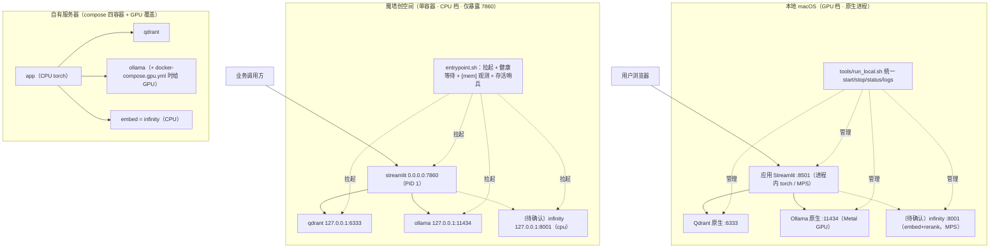
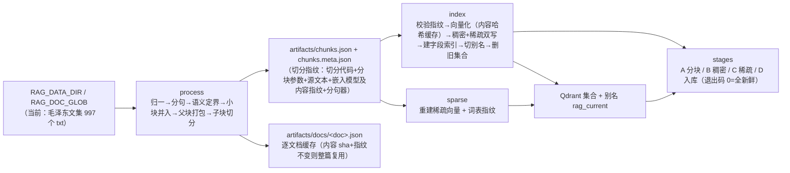
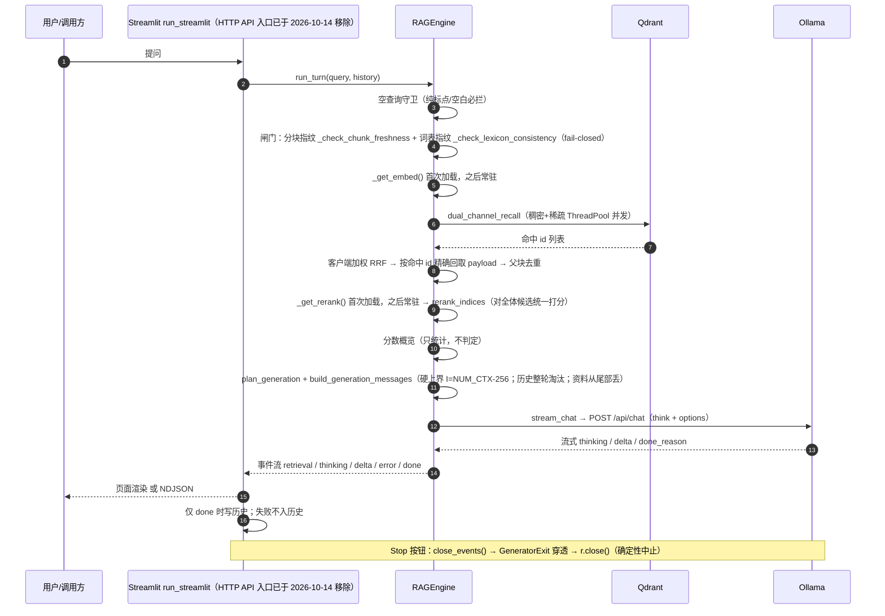
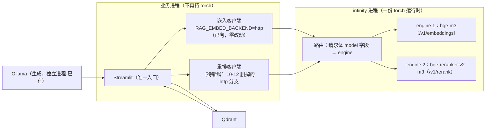
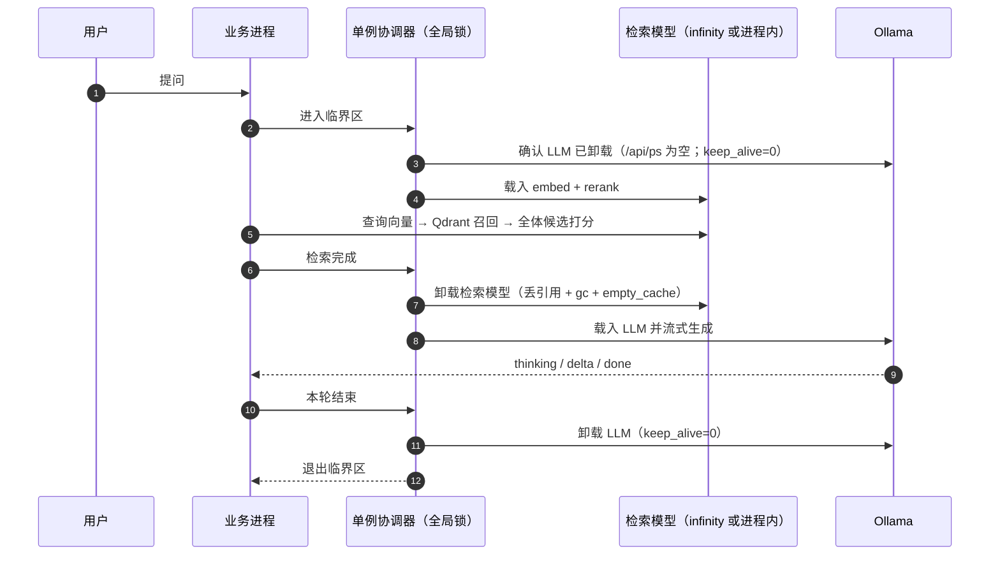

# 架构与业务流程（待确认稿）

> 本文是**待确认的架构提案 + 现状对照**，不是配置的第二权威：配置语义以 `chatbot.py` 与 `.env` 为准，
> 部署结论以 `AGENTS.md` 为准。确认后再决定是否并入 AGENTS.md。
>
> 标记约定：**[现状]** 已在运行 · **[本次已改]** 本次会话已落地 · **[待确认]** 提案，尚未实现。

---

## 0. 两地硬件事实（实测）

| | 本地 | 魔塔创空间 |
|---|---|---|
| 形态 | Apple M2 / 8 核 / **8 GB 统一内存** / macOS 14.8.9 | docker 类型单容器 / **2 vCPU / 8 GB**（MemTotal 8071 M） |
| 加速 | Metal（Ollama）+ MPS（torch） | 无 GPU |
| 端口 | 6333 / 11434 / 8501 | 仅 **7860** 对外 |
| 容器编排 | 不需要（全原生） | **平台不支持 compose**（`deploy_schema.json`：一个 Dockerfile → 一个容器） |
| 空闲实测 | free 64 MB、wired 4.25 G、swap 已用 5.4 G | MemAvailable 6756 M，容器基础开销仅 ~155 M |

---

## 1. 部署拓扑（三条路径）



**[本次已改]** `tools/run_local.sh`（本地一键起停，已在跑的实例复用、只停自己记录的）、`docker-compose.gpu.yml`（NVIDIA 主机只把生成模型交给 GPU）、`docker-compose.yml` 头部明确"只服务本地 Docker / 自有服务器"。

---

## 2. 离线流水线（process → index → sparse → stages）



**[本次已改] 影响面**：语料已换成毛泽东文集（997 个 txt，7.8 MB），而当前 `chunks.json` / Qdrant / 魔塔镜像仍是四大名著（22019 块）→ **A 阶段必然过期，必须重建**；若同时换 `RAG_EMBED_MODEL_PATH=bge-m3`，则 B 阶段也会全量重算。
**[不变式]** `process` 的语义定界与 `index` 入库**固定进程内 torch**，不受 `RAG_EMBED_BACKEND` 影响——离线命令仍需要本地权重。

---

## 3. 在线单轮问答（现状：三个模型全部驻留在业务进程/本机）



---

## 4. [待确认] 变更 A：检索侧拆出业务进程（infinity 单进程托管双模型）



- 依据：infinity 官方 CLI playbook（`infinity_emb>=0.0.34`，本仓库锁 0.0.77）"可重复 `--model-id`，单值广播 / 多值按位配对，请求按 `--served-model-name` 路由"；服务端 `app.engine_array[model]` 即按名查表。
- **净内存影响 ≈ +0.1 G**（权重两边都要出，业务进程省下 torch 壳）——拆分**不解决**容量问题。
- 阻断点：本项目 10-12 记录过 infinity × XLM-R 重排的 upstream bug，而 infinity CI 清单里又列了 `bge-reranker-v2-m3` → **必须先做一次分数比对**（`/v1/rerank` vs 进程内 `rerank_indices`）。

---

## 5. [待确认] 变更 B：懒加载 + 单例（跨进程互斥）



**资源时间线（为什么能压峰值）**

```
              检索阶段        生成阶段
embed   2.12  ████████
rerank  2.12          ████████
LLM     3.40                          ████████████
KV(f16) 1.90                          ███████
────────────────────────────────────────────────────
全驻留峰值 = 2.12+2.12+3.4+1.9 = 10.4 G   ❌
单例峰值   = max(4.64, 5.30)    =  5.3 G   ✅ 魔塔余 2.2 G
单例+q8_0  = max(4.64, 4.35)    =  4.64 G  ⚠️ 本地 7.4 G / 8.0 G
```

**落地前提（四处，均未实现）**
1. `RAG_PRELOAD=0`（已有开关）。
2. LLM 答完即卸：`chatbot.py` 目前不发 `keep_alive`，而魔塔 `entrypoint.sh` 是 `OLLAMA_KEEP_ALIVE=-1`（永不卸）→ 必须改 0 并轮询 `/api/ps` 确认真卸。
3. 新增检索模型卸载路径：`RAGEngine._get_embed/_get_rerank` 现在取到就永久缓存。
4. 跨进程互斥协调器（LLM 在 Ollama 进程、检索模型在另一进程）；代价是彻底放弃并发（与"不支持并发访问"现状一致）。

**未验证的最大风险**：PyTorch 释放 ≠ 内存归还系统（CPU 上 glibc 缓存、MPS 上 `empty_cache` 效果有限）——这条不成立，单例就只是纸面成立。

---

## 6. 改动清单

| # | 改动 | 状态 | 影响面 |
|---|---|---|---|
| 1 | `tools/run_local.sh` 本地三件套一键起停 | 已改 | 只影响启动方式，不进指纹 |
| 2 | `docker-compose.gpu.yml` GPU 覆盖 | 已改 | 只影响自有服务器路径 |
| 3 | compose 头部 + AGENTS.md 记录平台限制 | 已改 | 文档 |
| 4 | `_pid_alive` "ps 拿不到即按存活" | 已改 | `run_local.sh` / `run_qdrant.sh` |
| 5 | 语料换毛泽东文集 + 用 bge-m3 重建 | 待确认 | **A/B 阶段全量重建**，魔塔镜像需重烘 |
| 6 | `fetch_models.sh` 清单**改为按 .env 查表**并收录 bge-m3 / v2-m3 | **已改（代码）** | 镜像内容；不改指纹 |
| 7 | 检索侧拆 infinity 双模型 | **已改（代码）** | 查询侧链路；**分数比对仍未做** |
| 8 | 懒加载 + 单例（keep_alive=0、卸载路径、协调器） | **已改（代码）** | 生成与检索的时序；不改指纹 |

### 6.1 本轮实际落地的代码改动（2026-10-14，**未构建、未实跑**）

| 文件 | 改动 |
|---|---|
| `chatbot.py` | 新增 `RAG_RERANK_BACKEND`(torch\|http)/`RAG_RERANK_URL`/`RAG_RERANK_MODEL_NAME`；`RAG_EXCLUSIVE_MODELS`/`RAG_GEN_KEEP_ALIVE`；`_keep_alive_value()`（请求级 keep_alive，`stream_chat` 与预热探针都带）；`RAGEngine._http_rerank`（Cohere 形状，强制"全体候选都拿到分数"，条数/index 不符即报错）；`release_models()`（单例释放）；`load_rerank_tokenizer_only()`（http 重排下 steps 的 token 预算列，拿不到就 None）；`ensure_generation_unloaded()`（`/api/ps` + `keep_alive=0` + 轮询 + 超时告警）；`run_turn` 里"检索前确认生成已卸、检索后释放检索模型"；`_warm_engine` 仅在 torch 重排时加载重排 |
| `tools/fetch_models.sh` | 清单从写死两个模型改为 `_model_spec` 查表 + 按 .env 的 `RAG_*_MODEL_PATH` basename 选型；新增 bge-m3 / bge-reranker-v2-m3；未登记模型名判失败不静默 |
| `entrypoint.sh` | 3.5 段按 http 后端拉起 infinity（两模型同进程）、端口从 `RAG_EMBED_URL` 派生、等权重目录、`exec` 保 pid；存活哨兵加 `_said_m` |
| `Dockerfile` | 新增 infinity 安装层（`--constraint requirements.txt`，冲突即构建失败而非静默升级） |
| `embed.Dockerfile`、`docker-compose.yml` | 一个进程托管两个模型；app 环境加 `RAG_RERANK_*` |
| `tools/run_local.sh` | 三件套 → 四件套（新增检索模型服务，`--device mps`） |
| `.env` | `RAG_*_BACKEND=http`、模型名、`RAG_PRELOAD=0`、`RAG_EXCLUSIVE_MODELS=1`、`RAG_GEN_KEEP_ALIVE=0` |

**仍未验证（放行条件）**：① infinity 双模型能否正常启动、`/v1/rerank` 与进程内 `rerank_indices` 的分数是否一致；② PyTorch `release_models` 是否真把内存还给系统；③ 单例在真实 8 G 容器里的峰值。**本地还需 `pip install "infinity-emb[server,torch]==0.0.77"`**（当前未装，`run_local.sh status` 显示检索模型服务未响应）。

## 7. 需要你确认的点

1. 语料：确认就用毛泽东文集（997 个 txt），还是恢复四大名著？
2. 嵌入模型：确认升到 bge-m3（付一次全量重建），还是保持在产的 bge-base？
3. 检索侧是否拆 infinity？（拆之前先做 `/v1/rerank` 分数比对）
4. 是否采纳"懒加载 + 单例"？（魔塔因此可在免费档跑最高配；本地仍需换机或 q8_0 KV + 关掉其它程序）
5. 魔塔档位：免费 8 G 还是升 `paid/ecs.g8i.2xlarge`（8 vCPU / 32 G，¥2.4/h）？
6. 是否保留"生成无长度/时间闸、不重试"这条不变量（单例会把每轮装卸延迟 6–10 s 叠加到这条链路上）？
