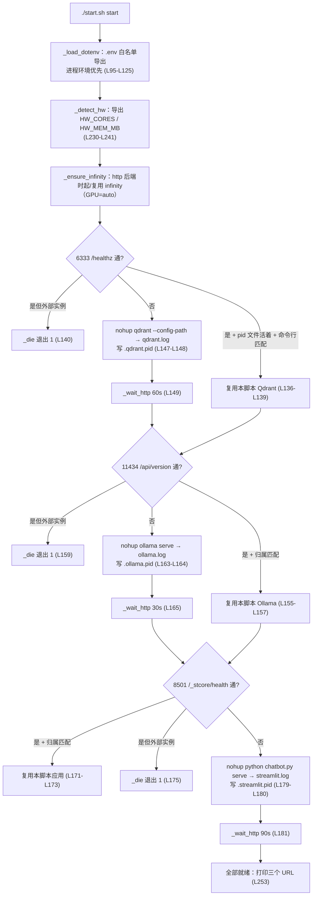
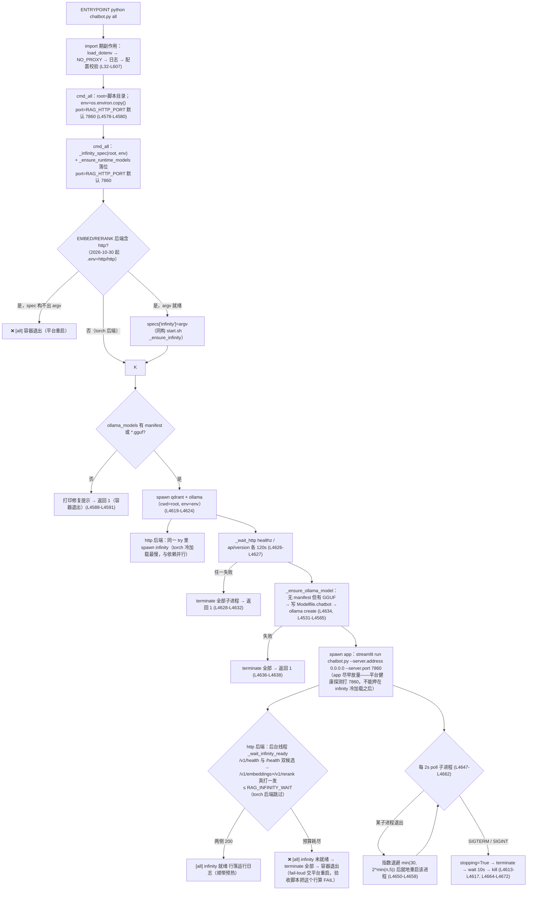
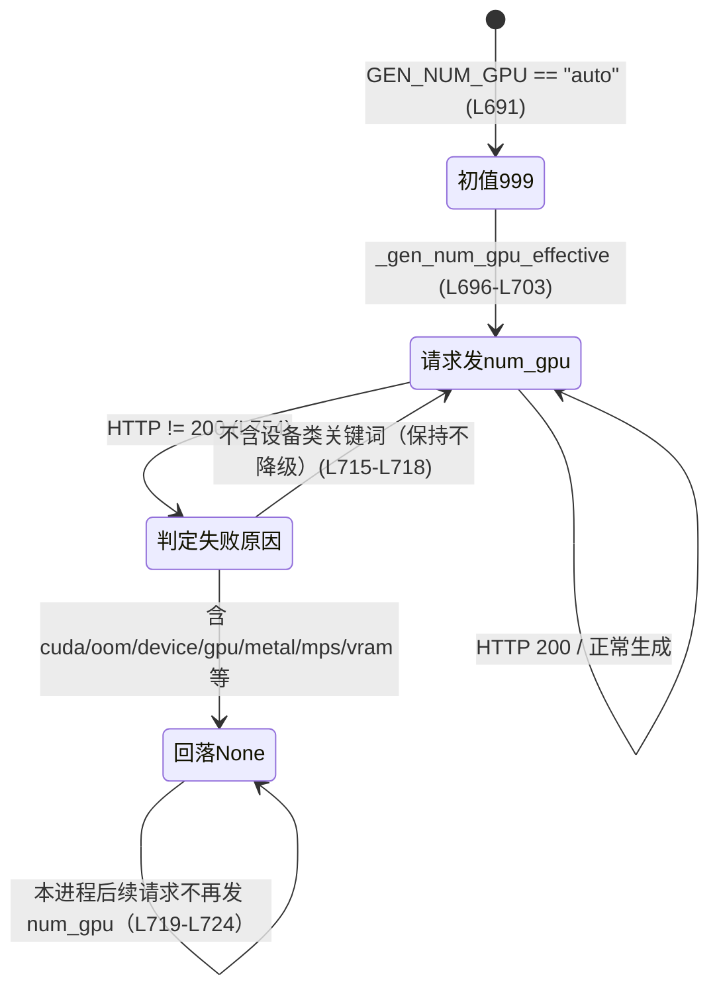
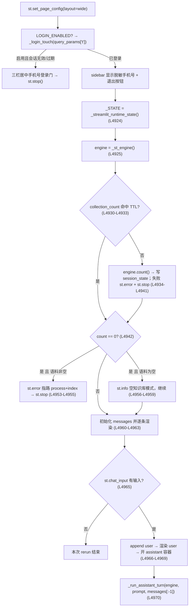

# 04 运行底座与接口层（runtime）

> 范围：`chatbot.py` L1–L127（分层与环境配置）、L127–L593（硬件/内存/cgroup 探测、离线并发推导、运行态单例、`_timed`）、L813–L1161（领域配置项与驻留策略定稿）、L4218–L4372（process/index 与 index 单例锁）、L4375–L4672（serve 门禁与 all 进程管理器）、L4675–L5042（Streamlit UI 与引擎单例/预热）、L5047–L5872（compare-chunks/sparse/lexicon/stages 工具与命令分发）；再叠加 `start.sh`、`Dockerfile`、`.env` 与 `.streamlit/config.toml` 的只读分析。
> 本文全部结论来自源码，引用格式为"文件:行号"。项目只有一个 Python 文件，因此所有 Python 逻辑都落在 `chatbot.py`。

---

## 0. 一页速览（10 条）

1. **L1 是唯一的"横切底座"**：配置、日志、硬件画像、运行态单例、单例锁全部集中在文件头部与各命令入口，只允许被上层依赖（L1–L9）。
2. **两种运行形态、一套代码**：本地 `start.sh` 编排 3 个独立进程；容器由 `python chatbot.py all` 编排同 3 个子进程，入口、配置、产物同源（`Dockerfile:L65-L88`、`chatbot.py:L4568-L4672`）。
3. **配置的优先级是"进程环境 > .env > 代码默认值"，且 .env 自称只做覆盖层**；非法值在 **import 期**具名报错，不静默回落（L49–L124、`.env:L8-L18`）。
4. **硬件自适应全部由三个派生函数收口**：`offline_workers()`（分块并行）、`embed_batch_size()`（嵌入批）、`qdrant_write_workers()`（写批并发），依据是 cgroup 探测 + 实测梯度/Little 定律，而不是照抄核数（L285–L346）。
5. **驻留策略 2026-10-24 定稿：应用层不做任何内存编排**——没有 gate、没有 keep_alive、没有 release；检索模型懒加载常驻，生成模型交给 Ollama 服务端策略，OOM 由进程管理器就地重启（L920–L929、L4146–L4148）。
6. **运行态单例只有一个根 `_RuntimeState`（双检锁）**，另外还有引擎 `_ENGINE`（RLock）与模型加载/推理两把锁；Streamlit 通过 `st.cache_resource` 桥接到同一个模块单例（L490–L527、L3696–L3750、L4973–L5042）。
7. **跨进程只有两把锁**：`artifacts/.index.lock`（index 与 sparse 共用，fail-fast + 陈旧锁自动接管 + PID 复用判据）与 `rag.log.lock`（flock 保护日志轮转，含 inode 复核）（L4223–L4356、L365–L439）。
8. **CLI 是单点命令表**：`COMMANDS` 一张 dict 同时驱动 usage、argparse 子命令与分发；`main()` 统一兜底异常并返回退出码，`__main__` 用 `get_script_run_ctx()` 区分"Streamlit 内运行"与"命令行"（L5800–L5872）。
9. **Streamlit 层是唯一 import streamlit 的地方**，其核心不变量是"失败/空答不入历史 + 孤儿 user 必回滚 + 停止要真正关上游流"（L4796–L4868）。
10. **本地与容器的差异只在编排层**：进程归属判据、重启语义、端口/绑定、环境变量注入路径、依赖就绪策略不同；检索/生成/切分/UI 逻辑不分叉（见 §10 差异矩阵）。

---

## 1. 该层在单文件分层中的位置与硬约束

文件开头就写死了分层与依赖方向（L1–L9）：

```
L1 配置/日志/硬件/运行态  →  L2 纯函数（domain）  →  L3 适配器（I/O/资源）
  →  L4 检索引擎（只依赖协议）  →  L5 编排（run_turn/CLI）  →  L6 Streamlit UI
```

四条约定（L4–L9）：

- **L2 纯函数不读全局配置、不碰 st/网络/磁盘**；需要配置时显式传参。
- **L3 适配器独占 requests / qdrant_client / torch 的 IO 与生命周期**。
- **L4 只依赖 L3 的 Protocol**；L6 是唯一允许 `import streamlit` 的层。
- **指纹单元源码禁改**：`_CHUNKING_CODE_UNITS` / `_embed_code_fingerprint` / `lexicon_fingerprint` 列出的函数，改名/加装饰器/改空白都会让 `inspect.getsource` 变化 → 触发全量重建（L8–L9）。这条约束对运行层的影响是：**不能给这些函数加 `_timed` 之类的装饰器**，所以横切计时只能显式挑"非指纹函数"（如 rerank，L3644）。

本文的 L1 不是"基础设施随便放"的杂物间，而是**明确规定了"谁拥有全局状态"**：

| 全局状态 | 唯一持有者 | 保护机制 | 生命周期 |
|---|---|---|---|
| 日志 handler / 级别 | `get_logger` 的模块级 `_LOG_FILE`（L442–L481） | `_LOG_FILE` 单例变量 | 进程 |
| 词表 / 生成 tokenizer / 别名缓存 | `_RuntimeState`（L498–L506） | `_STATE_LOCK` 双检 | 进程 |
| 可检索集合名/降级标记 | 同上 `alias_resolved / alias_degraded` | 双检 + 正缓存 | 进程 |
| 检索引擎（含模型、Qdrant client） | `_ENGINE`（L4974） | `_ENGINE_LOCK`（RLock） | 进程 |
| 模型加载 / 推理 | `RAGEngine._model_init_lock / _model_infer_lock`（L3696–L3697） | 两把独立锁 | 进程 |
| Ollama HTTP 连接 | `_OLLAMA_SESSION_TLS` 线程本地（L612–L646） | 线程本地，无锁 | 线程 |
| index/sparse 重建权 | `artifacts/.index.lock` 文件（L4232） | `O_CREAT / O_EXCL` + PID 校验 | 跨进程 |
| 日志轮转权 | `rag.log.lock` 文件（L392） | `fcntl.flock(LOCK_EX)` | 跨进程 |
| GPU 回落状态 | `_GEN_GPU_STATE` + `_GEN_GPU_LOCK`（L691–L693） | 互斥锁 | 进程 |
| 预热就绪标记 | `/tmp/warm_ready`（L5025–L5029） | 文件 | 进程/容器 |

**为什么把"线程本地 Session"排除在 `_RuntimeState` 之外**（L490–L497）：`requests.Session` 不保证线程安全，进程级单例会让预热线程与多个会话线程共用连接池；线程本地各持一份 keep-alive 收益不减，跨线程竞争消失（L634–L646）。

---

## 2. 启动时序

### 2.1 模块导入期（每个进程都会发生，包括 `--help`）

`chatbot.py` 在 import 时就产生副作用，顺序固定：

1. `from dotenv import load_dotenv` … `load_dotenv()`（L32–L36）。缺 python-dotenv 直接抛 `ImportError`，并明确提示"配置会静默退到代码默认值"，**不允许静默降级**。`load_dotenv()` 默认 `override=False`：**真实进程环境永远赢过 .env**。
2. **代理旁路**（L42–L45）：把 `127.0.0.1/localhost/::1` 幂等并入 `NO_PROXY/no_proxy`，避免本地 Ollama/Qdrant 被系统代理劫持后超时。之所以"幂等拼进去重"，是为了 reload/测试重复 import 时不再套一层。
3. **全局告警静音**（L46）：只过滤 tokenizer 的 "Token indices sequence length…" 噪声。
4. **日志单例建立**（L482–L483）：`console = get_logger("console")` / `logger = get_logger("rag_engine")`。`get_logger` 首次调用会挂 `_StdoutHandler`、打开 `RAG_LOG_FILE`（默认 `rag.log`，L442–L464）、读取 `RAG_LOG_LEVEL`（L474）。**因此任何命令启动都会创建/追加 rag.log**，哪怕只跑 `compare-chunks`。
5. **配置常量求值**（L570–L607、L827–L1100、L1279–L1290、L1923–L1926、L3034–L3174、L4880）。跨字段校验也在这时执行（见 §3.2）。**非法配置 = 所有命令都起不来**，这是有意的 fail-closed（L57、L113、L76–L80）。
6. `if __name__ == "__main__"`（L5863–L5872）：用 `get_script_run_ctx()` 判断是否被 Streamlit 脚本线程拉起；是则 `run_streamlit()`，否则 `sys.exit(main())`。这是"同一份文件既是 CLI 又是 Streamlit 应用"的唯一开关。

**取舍**：把配置和日志放在 import 期，换来"任何入口都拿到同一份已校验配置 + 同一份日志"，代价是**耦合了所有命令的启动条件**（见 §11 张力 1）。

### 2.2 本地形态：`./start.sh start`

`start.sh` 是本仓库唯一的 shell 文件（`start.sh:L1-L22` 头注释即用法），`set -euo pipefail`（L23）。



**进程复用判据（本层最容易被误读的一条）**：不是"端口健康就算复用"，而是 **pid 文件活着 + 命令行包含 marker**：

- `_pid_alive`（L45-L52）：`kill -0` + `ps -o stat=`，`Z` 状态（僵尸）视为死。
- `_running_pid`（L54-L60）：pid 文件存在且 pid 活着。
- `_owned_pid`（L62-L77）：`ps -ww -p pid -o command=` 的输出必须包含 marker（Qdrant 用 `qdrant`、Ollama 用 `ollama serve`、应用用 `chatbot.py`，见 L136、L155、L171、L225–L227）；若 `ps` 被沙箱拒绝，退到 `pgrep -f marker` 且精确匹配 pid。
- 端口通但**归属不匹配** → `_die` 直接失败（L140、L159、L175）。理由写在注释里（L62–L63）：健康端点本身不证明身份，否则旧进程/别的服务占着端口会被误当成"发布成功"（假发布）。

**依赖就绪等待**（`_wait_http`，L79-L93）除了健康端点，还会**同时观察 pid 是否还活着**：进程已死就立刻 tail 50 行日志并返回失败，不空等满超时。

**环境变量注入的唯一实现**是 `_load_dotenv`（L95-L125）：

- 逐行读、跳过空行/注释（L102–L104）、去行尾 `\r`、剥 `export ` 前缀、trim（L105–L106）；
- **只导出白名单前缀**：`RAG_* | OLLAMA_* | QDRANT_* | SEMANTIC_* | INDEX_* | MODEL | MODELS_DIR | HF_ENDPOINT | HF_HUB_* | PYTORCH_MPS_*`（L111–L114）——这是有意的收窄，避免 `.env` 里随便写的东西污染子进程环境；
- **同名后者覆盖前者，但进程已有环境优先**：先抓一份 `_preset` 环境变量名清单（L101），命中就 `continue`（L115）；
- 值支持双引号/单引号/裸值 + 行内 `#` 注释剥离（L118–L122）。

**启动器命令面**（L247–L266）：

| start.sh 命令 | 行为 | 关键行 |
|---|---|---|
| `start` | 依次起 Qdrant → Ollama → 应用（已在跑则复用） | L248–L254 |
| `stop` | 按 pid 文件逆序停应用/Ollama/Qdrant；10s 不退则 SIGKILL | L185–L208 |
| `restart` | 先 stop 再调自己 start | L256 |
| `status` | 三组件健康 + pid，区分"本脚本实例/外部实例" | L210–L228 |
| `logs` | `tail -F qdrant.log ollama.log streamlit.log` | L258 |
| `serve` | 前台 `exec python chatbot.py serve`（调试用） | L259 |
| `process/index/sparse/stages/lexicon/compare-chunks` | `exec python chatbot.py <cmd> "$@"` 原样透传 | L260–L262 |
| `help/-h/--help` | `sed -n '2,22p' start.sh` 打印头注释 | L243、L264 |
| 其它 | 打印用法、退出 2 | L265 |

注意 `exec` 透传（L259、L262）：`serve` 会**用新进程映像替换 shell**，pid 不变，所以 `.streamlit.pid` 依然有效；一次性命令不写 pid 文件。

### 2.3 容器形态：`ENTRYPOINT python chatbot.py all`

`Dockerfile` 是多阶段构建（详见 §10），最终入口只有一行：`ENTRYPOINT ["python","chatbot.py","all"]`（L88）。**没有 shell、没有 entrypoint.sh**（L1–L9、`README.md:L119-L131`）。



关键细节：

- `env = os.environ.copy()`（L4579）：容器里 `.env` 已经由 import 期 `load_dotenv()` 写进本进程环境，所以**三个子进程自动继承**——这就是 `.env` 里那句"容器：`chatbot.py all` 在启动 `ollama serve` 之前加载 .env"的实际机制（`.env:L29-L32`）；代码里没有 `_load_dotenv` 这个函数（区别于 start.sh）。
- `signal` 只置 `stopping` 标志（L4613–L4617），真正的 terminate 在主循环退出后统一执行（L4664–L4672），避免信号处理器里做重活。
- 重启退避：`min(30, 2 ** min(attempt, 5))` → 2,4,8,16,30,30…（L4651–L4653）；`restarts` 计数**永不重置**（L4646–L4652），长跑后崩溃固定 30s 退避。
- Qdrant/Ollama 起不来或模型创建失败 → **容器直接退出**（交平台重启），不启动"半残应用"（L4628–L4638、`README.md:L166`）。
- app 先于 infinity 就绪放量（2026-10-31 起两段式）：阻塞旧版把 7860 首听拖到 torch 双模型冷加载之后，撞平台部署健康探测窗口（23:53 场 DeployFailed、运行日志 0 行的头号嫌疑）。现在 app 在 qdrant/ollama 就绪后立即 spawn，infinity 的就绪由守护线程 `_wait_infinity_ready` 确认——/health 双候选（0.0.76 实测 /v1/health 404、只有裸 /health）→ `/v1/embeddings`+`/v1/rerank` **真打一发**，双 200 才落 `[all] infinity 就绪` 行，跑满 `RAG_INFINITY_WAIT` 未过就 ❌ + 自尽容器。warmup calibration 批成本实证：`--batch-size 32` 一批 32×513 token 44s、Mac 全链 8 min 未绑票；batch 8 全链 69s 就绪、RSS 峰 2.17GB（.env 已定 batch 8 / wait 1200）。
- `_infinity_spec(root, env)` 的路径/名字/参数读**调用方传入的子进程 env**（落位改写只写 children env dict，读 os.environ 看不到）；`--model-id` 用 env 值原样传（与 start.sh `_ensure_infinity` 同构；子进程 cwd=root）。
- `cmd_all` 不调用 `_qdrant_gate`（对比 `cmd_serve`）——空知识库在容器里不会 fail-fast，改由 UI 的计数检查兜底（见 §8 与 §11 张力 8）。
- Qdrant 配置文件里写的 `storage_path: /qdrant/storage`（`qdrant_config/config.yaml:L6-L7`）会被 `all` 的 `setdefault` 覆盖成 `/app/storage`（L4583-L4584）；显式环境变量仍然优先。
- Streamlit 的项目级配置在 `.streamlit/config.toml`（`address=127.0.0.1`、`port=8501`、`headless=true`、`corsAllowedOrigins` 两个创空间域名、`toolbarMode=minimal`、`showErrorDetails=none`、`gatherUsageStats=false`，L1–L25）；`all` 用 CLI 参数把地址/端口改成 `0.0.0.0:7860`（L4596-L4599），CLI 优先级高于该文件。

### 2.4 五种入口的时序对比

| 入口 | 触发 | 是否做 Qdrant 门禁 | 是否创建引擎 | 进程模型 | 退出语义 |
|---|---|---|---|---|---|
| `python chatbot.py <工具命令>` | `main()` L5834 | 否（工具自连） | 否 | 一次性进程 | `sys.exit(main())`，退出码见 §7.3 |
| `python chatbot.py serve` | `cmd_serve` L4457 | 是（`_qdrant_gate` L4418-L4454） | 在 Streamlit 脚本线程里懒建 | `os.execv` 替换为 streamlit 进程（L4477） | 门禁失败 `sys.exit(1)`；端口被外部占用 `sys.exit(1)`；本项目已在跑 `sys.exit(0)` |
| `python chatbot.py all` | `cmd_all` L4568 | 否 | 间接（Streamlit 内） | 父进程监督子进程=3+（http 后端时 infinity 为第 4 个） | 0/1（见上） |
| `streamlit run chatbot.py` | `run_streamlit` L4904 | 否（UI 自己 count） | 是（`_st_engine`） | Streamlit 自己管理 | 由 Streamlit 决定 |
| `./start.sh start` | shell | 间接（`serve` 门禁） | 间接 | 3 个独立 nohup 进程 | shell 退出码 |

### 2.5 启动失败面（fail-closed 清单）

| 失败点 | 行为 | 位置 |
|---|---|---|
| 缺 python-dotenv | import 期 `ImportError` | L32–L35 |
| 配置非法（int/bool/choice/下限/跨字段） | import 期 `ValueError`，所有命令不可用 | L49–L124、L842、L963–L969、L1092–L1096、L3151–L3155 |
| `RAG_LOG_LEVEL` 写错 | **不致命**：warning + 回退 INFO | L474–L478 |
| 日志文件打不开 | **不致命**：退回仅控制台 | L448–L464 |
| Qdrant 连不上/集合空但语料非空 | `sys.exit(1)` + 指路 `process && index` | L4431–L4446 |
| 8501 被外部进程占用 | `sys.exit(1)` + `lsof` 指路 | L4461–L4466 |
| 容器缺 qdrant/ollama 可执行 | 返回 1 | L4601–L4604 |
| 容器 ollama_models 既无 manifest 也无 GGUF | 返回 1 + 挂载提示 | L4588–L4591 |
| Qdrant/Ollama 120s 未就绪 | terminate 子进程 → 返回 1 | L4626–L4632 |
| `ollama create` 失败 | terminate → 返回 1 | L4634–L4638 |
| index 锁被占 | `cmd_index` 打印后返回 1 | L4359–L4365 |
| index 可开内存低于门槛 | `RuntimeError`（main 兜底返回 1） | L2494–L2504 |

---

## 3. 配置系统

### 3.1 读取与校验规则

七个 helper 是**唯一读取入口**（L49–L124）：

| helper | 缺省/空值 | 非法值 | 备注 |
|---|---|---|---|
| `env_int`（L49-L56） | 返回 default | `ValueError` 并报变量名 | 空串视为未设置 |
| `env_float`（L59-L66） | default | 同上 | |
| `env_int_min`（L69-L73） | default | 非法/小于 minimum 报错 | 大量"负值会炸下游"的配置都用它 |
| `env_float_min`（L76-L80） | default | 同上 | |
| `env_bool`（L87-L104） | default | **只认显式真/假集合，其余报错** | 真 `1/true/yes/on`，假 `0/false/no/off`；理由是旧实现把拼错的 `flase/2/禁用` 静默取真（L88–L93） |
| `env_choice`（L107-L114） | default | 不在 allowed 报错 | 用于 `RAG_RERANK_ON/RAG_EMBED_BACKEND/RAG_RERANK_BACKEND` |
| `env_int_any`（L117-L124） | default | 报出**具体那个**名字 | 等价旧 `os.getenv(a) or os.getenv(b)` 链，但错误可归因；仅 `QDRANT_PORT` 使用（L985） |

**优先级链**（从强到弱）：

```
真实进程环境
  > .env（import 期 python-dotenv override=False；start.sh 的 _preset 跳过已存在键）
    > 代码默认值（"代码默认值为准"，.env:L8-L18）
```

注意：`.env:L8` 明确写"**代码默认值为准**，本文件只做覆盖层"；`.env:L13-L16` 又规定"只写与代码默认不同、需要覆盖的值，且要写为什么"。这是本仓库对"配置漂移"的制度性回答。

**两个"不抛异常"的例外**，都写在注释里：

- `_probe_positive_int`（L139-L148）：探测类环境变量（`HW_CORES` 等）非法/空返回 None，由调用方回退，**探测失败不阻断启动**。
- `RAG_LOG_LEVEL`（L474-L478）：笔误只 warning + INFO，理由是"一个笔误不该让所有命令起不来"。

**生效时机**：几乎所有配置在 import 期求值为模块常量（L570 起），因此**进程启动后改 .env 不生效**，必须重启（`start.sh:L172` 的提示、`cmd_serve:L4468`）。少数是调用期读取：`RAG_LOG_FILE`（首次 get_logger 时）、`RAG_HTTP_PORT`（cmd_all 内，L4580）、start.sh 的 `RAG_LOCAL_PORT`（L29）。

### 3.2 跨字段交叉校验（启动即报错）

| 校验 | 规则 | 位置 |
|---|---|---|
| 来源字段保留字 | `RAG_SOURCE_FIELD` 不得落入 `_RESERVED_SOURCE_FIELDS`（内部 payload 键 + 对外输出键） | L831–L846 |
| 父子块容量 | `CHILD_MAX_TOKENS <= PARENT_MAX_TOKENS` | L963–L964 |
| 重叠与容量 | `CHUNK_OVERLAP < CHILD_MAX_TOKENS`（否则 splitter 每篇都抛，process 全量失败） | L965–L969 |
| RRF 权重 | 稠密/稀疏权重不能同时为 0（两条召回都退出 = 检索恒空） | L1092–L1093 |
| 召回首数 | `RAG_RECALL_LIMIT >= 0`（0 = 跟随 `RAG_RERANK_TOP_K`） | L1094–L1097 |
| 窗口与预留 | `RAG_NUM_CTX > RAG_INPUT_RESERVE`（否则输入上界 ≤ 0，装配会截出空提问） | L3151–L3155 |
| GPU 层数 | `RAG_GEN_NUM_GPU` 只能是 int 或 `auto`，且 ≥ -1 | L941–L952 |

### 3.3 配置键分类表（代码默认值为准）

> 说明：默认值一律取自代码（括号内），若本仓库 `.env` 覆盖了它，会在"生效值"里标注。`.env` 全量注释本身也是重要文档（见 L1–L346）。

#### A. 进程/日志/运行态

| 键 | 代码默认 | 作用与要点 | 位置 |
|---|---|---|---|
| `RAG_LOG_FILE` | `rag.log` | 共享日志文件；打开失败退回仅控制台 | L445、L457 |
| `RAG_LOG_LEVEL` | `INFO` | 非法值 warning + 回退 INFO | L474–L478 |
| `RAG_PRELOAD` | `True` | 是否后台预热（词表/嵌入/重排/生成探针） | L895 |
| `HW_CORES / HW_MEM_MB` | 无（探测） | 机器事实契约值，显式覆盖优先 | L196–L210 |
| `HW_THREADS / TORCH_NUM_THREADS / OMP_NUM_THREADS` | 无 | 仅当核数探测失败时的回退来源 | L211–L218 |

#### B. 生成（Ollama 客户端）

| 键 | 代码默认 | 作用与要点 | 位置 |
|---|---|---|---|
| `OLLAMA_BASE_URL` | `http://localhost:11434` | 派生 `API_URL = {base}/api/chat` | L570–L571 |
| `MODEL` | `qwen3.5:2b-q4_K_M`（.env 覆盖为 `minicpm5-2b`） | 生成模型短名 | L572 |
| `RAG_THINK` | `False`（.env=1） | 思维链唯一开关；思考只展示、不进生成上下文 | L574、L1123–L1135 |
| `RAG_NUM_CTX` | `8192`（.env=32768） | 窗口 | L577 |
| `RAG_NUM_PREDICT` | `4096`（.env=0=不限长→发 -1） | 输出上限；≤0 映射 -1 | L578、L671、L4143–L4144 |
| `OLLAMA_TIMEOUT` | `180`（.env=900） | 非流式/请求总超时（预热也用） | L579 |
| `RAG_STREAM_READ_TIMEOUT` | `300` | 流式读空闲超时 | L583 |
| `RAG_TURN_TIMEOUT` | `1800` | 整轮硬上限 | L584 |
| `RAG_TEMPERATURE` | `0.0` | 贪心；问答复现 | L586 |
| `RAG_REPEAT_LAST_N` | `64`（.env=128） | 三类惩罚共用回看窗口 | L589 |
| `RAG_GEN_TOP_K/TOP_P/MIN_P` | `20 / 0.9 / 0.0` | 温度 0 下空转，保留 A/B | L597–L599 |
| `RAG_GEN_PRESENCE_PENALTY/FREQUENCY_PENALTY` | `0.0 / 0.0` | 惩罚 | L603–L604 |
| `RAG_GEN_REPEAT_PENALTY` | `1.1` | 贪心上唯一生效的防循环 | L605 |
| `RAG_GEN_SEED` | `-1` | 随机种子 | L607 |
| `RAG_GEN_NUM_GPU` | 空 | `0/999/int/auto`；auto = GPU 优先失败回落 | L941–L952、L696–L724 |
| `RAG_INPUT_RESERVE` | `256`（.env=0） | 从窗口扣给模板的余量 | L3148 |
| `RAG_GEN_HISTORY_MAX_TOKENS` | `0` | 历史 token 硬上限（0=不设） | L3159 |
| `RAG_GEN_TOKENIZER_PATH` | 空（.env=`artifacts/gen_tokenizer`） | 精确 token 计数 | L3169 |
| `RAG_GEN_GGUF_PATH` | 空 | 显式 GGUF 路径（tokenizer 兜底） | L3171 |
| `OLLAMA_MODELS` | `~/.ollama/models` | 模型目录（容器 setdefault 到 `/app/ollama_models`） | L3174、L4585 |

#### C. 检索 / 融合 / 装配

| 键 | 代码默认 | 作用与要点 | 位置 |
|---|---|---|---|
| `RAG_TOP_K` | `5` | 最终返回条数 | L847 |
| `RAG_RERANK_TOP_K` | `20`（.env 已移除该键） | 候选池截断与预算观测机制已随"不用截断"整体删除（2026-10-30 两度拍板）；本键仅作 RAG_RECALL_LIMIT 缺省跟随源 | L848 |
| `RAG_RERANK_BATCH` | `32` | 重排批大小 | L892 |
| `RAG_RERANK_MAX_LENGTH` | `384` | 重排截断长度 | L893 |
| `RAG_RERANK_ON` | `child` | 判子块/父块（choice） | L894 |
| `RAG_RECALL_LIMIT` | `0` | 0 = 跟随 `RERANK_TOP_K` | L1094–L1097 |
| `RAG_RRF_K` | `60` | RRF 平滑常数 | L1089 |
| `RAG_RRF_DENSE_WEIGHT/SPARSE_WEIGHT` | `1.0 / 1.0` | 不能同时 0 | L1090–L1093 |
| `RAG_DEDUP_BY_PARENT` | `True` | 同父块兄弟去重 | L1098 |
| `RAG_EMBED_QUERY_INSTRUCTION` | 空 | 空 = 裸查询嵌入 | L1100 |
| `RAG_USE_CONTEXT` | `True` | 对照模式开关（0=不注入资料） | L3143 |
| `RAG_CONTEXT_LABELS/TAGS/META` | `True/True/True`（.env 全 0/0/1） | 资料注入形态；META 优先接管 | L3034–L3047 |

#### D. 模型与后端

| 键 | 代码默认 | 作用与要点 | 位置 |
|---|---|---|---|
| `RAG_EMBED_BACKEND` | `torch` | `torch` = 进程内；`http` = OpenAI 兼容 `/v1/embeddings`（**.env 现行 = http**，2026-10-30） | L901 |
| `RAG_EMBED_URL` | `http://127.0.0.1:8001/v1` | 带 `/v1` 是契约 | L905 |
| `RAG_EMBED_MODEL_NAME` | `bge-base-zh-v1.5`（.env=`bge-m3`） | 服务端注册名；运行期合同三查会核 | L908 |
| `RAG_MODEL_HTTP_TIMEOUT` | `60` | http 后端单项超时 | L911 |
| `RAG_RERANK_BACKEND` | `torch`（.env 现行 = http） | http 契约严：必须一次给全部候选分 | L912–L917 |
| `RAG_RERANK_URL` | 同 `EMBED_URL` | | L918 |
| `RAG_RERANK_MODEL_NAME` | `bge-reranker-v2-m3` | | L919 |
| `RAG_EMBED_MODEL_PATH` | `./models/bge-base-zh-v1.5`（.env=`./models/bge-m3`） | 进程内检索模型 | L1002 |
| `RAG_RERANK_MODEL_PATH` | `./models/bge-reranker-base`（.env=`./models/bge-reranker-v2-m3`） | | L1003 |
| `INDEX_DEVICE` | 空 | 空 = 自动（`get_device`）；可钉 `cpu/mps/cuda` | L977、L1148–L1154 |
| `RAG_EMBED_BATCH_SIZE` | `0`=派生 | 显式 >0 时优先 | L973–L974 |
| `RAG_WEIGHTS_BACKGROUND` | `False` | 后台下载时允许轮询等待权重 | L1008 |
| `RAG_MODEL_WAIT_SECS` | `900` | 等待上限 | L1009 |
| `RAG_EMBED_CACHE` | `True` | 稠密向量缓存 | L1017 |

#### E. 语料 / 分块

| 键 | 代码默认 | 作用与要点 | 位置 |
|---|---|---|---|
| `RAG_DATA_DIR` | `corpus` | 语料目录；`RAG_BOOKS_DIR` 为遗留别名 | L827 |
| `RAG_DOC_GLOB` | `*.txt` | 文档通配 | L828 |
| `RAG_SOURCE_FIELD` | `source` | 来源键名（同时是 payload 键），有保留字校验 | L829、L831–L846 |
| `RAG_SOURCE_LABEL` | `来源` | 展示标签 | L830 |
| `RAG_CHILD_MAX_TOKENS` | `128` | 子块容量 | L953 |
| `RAG_PARENT_MAX_TOKENS` | `512` | 父块容量 | L954 |
| `RAG_CHUNK_OVERLAP` | `32` | 必须 < 子块容量 | L957、L965–L969 |
| `RAG_PARENT_MIN_TOKENS` | `192` | 短父块合并阈值 | L958 |
| `RAG_CHILD_MIN_TOKENS` | `32` | **死配置**：只做解析校验，无消费点，已从切片指纹移除 | L959–L962 |

#### F. 词表 / 文本归一

| 键 | 代码默认 | 作用与要点 | 位置 |
|---|---|---|---|
| `RAG_LEXICON_DIR` | `./lexicon` | 词表目录 | L1019 |
| `RAG_ALIASES / RAG_STOPWORDS` | `True / True` | 别名归一/停用词开关 | L1923–L1924 |
| `RAG_ALIASES_FILE / RAG_STOPWORDS_FILE` | `<dir>/aliases.txt / <dir>/stopwords.txt` | 找不到旧名 `stopwords_classical.txt` 会回退并告警 | L1925–L1930 |
| `NORMALIZE_QUOTES` | `True` | 引号归一逃生开关 | L1279、L1348 |
| `RAG_TEXT_OPENCC` | `t2s` | 繁简转换 | L1290 |

#### G. 存储 / Qdrant / 产物

| 键 | 代码默认 | 作用与要点 | 位置 |
|---|---|---|---|
| `QDRANT_HOST`（别名 `RAG_QDRANT_HOST`） | `localhost` | 主名优先，别名兼容 | L984 |
| `QDRANT_PORT`（别名 `RAG_QDRANT_PORT`） | `6333` | `env_int_any` 按序取第一个已设 | L985 |
| `QDRANT_API_KEY`（别名 `RAG_QDRANT_API_KEY`） | `None` | 不接这条通路会全 401 | L986–L988 |
| `RAG_QDRANT_TIMEOUT` | `60` | 普通查询；sparse 批量用 2× | L989–L991 |
| `RAG_COLLECTION_BASE` | `rag_documents_v1` | 集合名基 | L998 |
| `RAG_COLLECTION_ALIAS` | `rag_current` | 原子切别名 | L1000 |
| `RAG_USE_COLLECTION_ALIAS` | `True` | 关掉则直读基线集合 | L1001、L3005–L3027 |
| `RAG_ARTIFACTS_DIR` | `./artifacts` | chunks/cache/docs/锁/turns 的根 | L1010 |
| `RAG_INDEX_WRITE_WORKERS` | `0`=派生 | 写批/页并发覆盖 | L994 |
| `RAG_INDEX_MIN_FREE_MB` | `0`（.env=2048） | index 可开内存闸门（0=关） | L983 |
| `RAG_COLLECTION_COUNT_TTL_S` | `300` | UI/门禁的 count 缓存 TTL（0=禁用） | L997 |

#### H. 诊断 / UI

| 键 | 代码默认 | 作用与要点 | 位置 |
|---|---|---|---|
| `RAG_MEM_GUARD` | `True` | 内存熔断总开关（不限制人数/并发/排队） | L598 |
| `RAG_MEM_KILL_PCT` | `95.0` | 触发水位（psutil 口径）；触线中止本轮，不卸载模型 | L599 |
| `RAG_MEM_SAMPLE_MS` | `500` | 生成中采样间隔（按墙钟非行数） | L600 |
| `RAG_TURN_STATS` | `False`（.env=1） | 单轮台账（诊断默认关） | L1040 |
| `RAG_TURN_STATS_FILE` | `artifacts/turns.jsonl` | 追加式 JSONL | L1041 |
| `RAG_LOGIN_ENABLED` | `True`（.env=1） | 登录门总开关（本地手机号模式，无 `[auth]`/OAuth） | L5489 |
| `RAG_LOGIN_IDLE_TTL_S` | `3600` | 会话闲置过期（每次 rerun 顺延） | L5494 |
| `RAG_LOGIN_ABS_TTL_S` | `43200` | 会话绝对上限 | L5495 |

#### I. 启动器 / 容器专用（非 chatbot.py 全局配置）

| 键 | 默认 | 读取方 | 说明 |
|---|---|---|---|
| `PYTHON` | `python` | start.sh L28 | 解释器 |
| `RAG_LOCAL_PORT` | `8501` | start.sh L29 | **只用于 start.sh 的健康检查 URL** |
| `QDRANT_BIN` | `.bin/qdrant/qdrant` | start.sh L33、chatbot L4581 | 本地可执行；容器默认 `/usr/local/bin/qdrant` |
| `OLLAMA_BIN` | `/usr/local/bin/ollama` | chatbot L4582 | 仅 `all` 用 |
| `RAG_HTTP_PORT` | `7860` | chatbot L4580 | 仅 `all` 的 Streamlit 端口 |
| `QDRANT__SERVICE__HOST / QDRANT__STORAGE__STORAGE_PATH` | `127.0.0.1 / <root>/storage` | start.sh L144–L145、chatbot L4583–L4584 | `setdefault/export`，显式环境优先 |

#### J. Ollama 服务端变量（代码不读，由"拉起 ollama 的环境"注入）

| 键 | 本仓库来源 | 作用 |
|---|---|---|
| `OLLAMA_KV_CACHE_TYPE` | `.env:L49` → start.sh 白名单 / 容器 `os.environ.copy()` | `q8_0` 是 8G 档硬要求（f16 KV 放不下） |
| `OLLAMA_FLASH_ATTENTION` | `.env:L50` | KV 量化生效前提 |
| `OLLAMA_NUM_PARALLEL` | `.env:L51` | 单槽，避免多份 KV |
| `OLLAMA_NUM_THREADS` | **刻意不写**（`.env:L52-L60`） | 由机器派生（`HW_THREADS`） |
| `OLLAMA_KEEP_ALIVE / OLLAMA_MAX_LOADED_MODELS` | **不写**（`.env:L163-L170`） | 驻留完全交给 Ollama 自身策略 |

### 3.4 别名、遗留与"写了无效"

| 类型 | 名字 | 状态 |
|---|---|---|
| 主名/别名 | `QDRANT_HOST / RAG_QDRANT_HOST`、`QDRANT_PORT / RAG_QDRANT_PORT`、`QDRANT_API_KEY / RAG_QDRANT_API_KEY` | 都生效，主名优先（L984–L988） |
| 遗留别名 | `RAG_BOOKS_DIR` → `RAG_DATA_DIR` | 仍生效（L827） |
| 遗留来源键 | `source / book` | `SOURCE_PAYLOAD_FIELDS` 单点定义（L1032） |
| 死配置（只解析不消费） | `RAG_CHILD_MIN_TOKENS` | 无消费点（L959–L962） |
| 已删除、写了无效 | `RAG_EXCLUSIVE_MODELS / RAG_GEN_KEEP_ALIVE / RAG_EXCLUSIVE_AUTO_FREE_MB / RAG_TURN_MIN_FREE_MB` | `.env:L322-L323` 明示 |
| 已删除、写了无效 | `SEMANTIC_EMBED_DEVICE`（L975–L976）、`RAG_CONTEXT_ROLE`（L3141）、`RAG_SYSTEM_RULES`（L3140）、`ENABLE_QUERY_EXPANSION / RAG_FULL_RERANK / RAG_ABSTAIN*`（`.env:L154-L161`） | 代码无引用 |
| **本仓库代码不读**（但 .env 还留着） | `RAG_SENTENCE_LANG`、`RAG_GEN_MODEL_MODELSCOPE`、`RAG_OLLAMA_DL_CONNS`、`RAG_MODEL_DL_CONNS` | 全仓 grep 无引用；`.env:L74-L95`、L105 仍描述它们（已移除的构建期/entrypoint 能力）——见 §11 张力 3 |

### 3.5 本仓库 .env 的相对覆盖（与代码默认的差）

只列"改了默认/会影响行为"的项（`.env` 全部注释见 L1–L346）：

| 键 | 代码默认 → .env 生效 | 影响 |
|---|---|---|
| `MODEL` | `qwen3.5:2b-q4_K_M` → `minicpm5-2b` | 生成模型（L76） |
| `RAG_THINK` | `False` → `1` | 思维链开（L190） |
| `RAG_NUM_CTX` | `8192` → `32768` | 8G 档折中（L202；原 131072 会顶破） |
| `RAG_NUM_PREDICT` | `4096` → `0`（-1 不限长） | 输出不限长（L205） |
| `RAG_INPUT_RESERVE` | `256` → `0` | 窗口全给输入（L217） |
| `OLLAMA_TIMEOUT` | `180` → `900` | 慢冷启动可等（L253） |
| `RAG_REPEAT_LAST_N` | `64` → `128` | 防长间隔复读（L236） |
| `RAG_GEN_NUM_GPU` | 空 → `auto` | 本地 Metal 全 GPU；纯 CPU 容器回落（L332） |
| `RAG_EMBED_MODEL_PATH` | `bge-base-zh-v1.5` → `bge-m3` | 换嵌入=全量重建（L293） |
| `RAG_RERANK_MODEL_PATH` | `bge-reranker-base` → `bge-reranker-v2-m3` | 只换目录（L295） |
| `RAG_RERANK_TOP_K` | 已从 .env 移除 | 候选池上限已退场（2026-10-30"不用截断"） |
| `RAG_INDEX_MIN_FREE_MB` | `0` → `2048` | index 前 fail-closed 闸门（L338） |
| `RAG_TURN_STATS` | `False` → `1` | 线上诊断开（L343） |
| `RAG_LOGIN_ENABLED` | `True` → `1` | 开本地手机号登录（.env） |
| `PYTORCH_MPS_HIGH/LOW_WATERMARK_RATIO` | 未设 → `1.0/0.9` | 防 MPS 换页拖死整机（L132–L142） |
| `RAG_CONTEXT_LABELS/TAGS` | `True/True` → `0/0` | 但 `RAG_CONTEXT_META=1` 接管，故不参与（L111–L121） |
| `RAG_EMBED_BACKEND/RERANK_BACKEND` | 都是 `http`（2026-10-30 起，同一 infinity 双模型；旧值 torch/进程内） | start.sh `_ensure_infinity` 编排 |
| `RAG_INFINITY_BATCH` | 未设（代码缺省 32）→ `8`（2026-10-31） | warmup calibration 批成本实证：32×513 tk 一批 44s、Mac 全链 8 min 不绑票；8 全链 69s 就绪、RSS 峰 2.17GB（检索请求 1-20 条，服务面无差） |
| `RAG_INFINITY_WAIT` | 未设（代码缺省 900/300）→ `1200` | 容器 2vCPU 冷启动预算；监听后 embeddings/rerank 真打一发再放行 |

### 3.6 配置系统的取舍

- **好处**：所有配置在 import 期求值 → 任何入口、任何线程拿到的都是同一份已校验值；没有"函数里再读一次环境变量"导致的分叉（`build_runtime_profile`（L540-L553）把设备/精度/批/线程打成不可变值对象就是同一思路）。
- **代价**：配置错误会阻断**所有**命令，包括纯文件命令（`compare-chunks`）。这是刻意选择——宁可起不来，也不要在"配置写错却静默退回默认"的原型上翻身（见 `env_bool` 注释 L88–L93）。
- **.env 只写覆盖层**的制度化，减少了"同一事实两处存"的分叉，但也带来"注释里保留已删键"的漂移（§11 张力 3）。

---

## 4. 硬件画像与自适应派生

### 4.1 三条事实来源与探测链

`_hw_facts()`（L191-L220）的优先级：

```
HW_CORES / HW_MEM_MB（契约值，显式即用，不封顶）
  → cgroup v2（cpu.max / memory.max）
    → cgroup v1（cpu.cfs_quota_us / cpu.cfs_period_us、memory.limit_in_bytes）
      → 线程族回退（HW_THREADS / TORCH_NUM_THREADS / OMP_NUM_THREADS）
        → 安全回退（4 核、内存未知）
```

- `_cgroup_facts`（L151-L188）：v2 用 `cpu.max` 的 `quota/period` 向上取整，v1 用 `cfs_quota/cfs_period`；内存先读 `memory.max` 再读 v1 `limit_in_bytes`，过滤 `max`/天文数（≥2^60）。
- 结果缓存进 `_HW_PROBE["facts"]`（L136、L219-L220），进程内只探一次。
- `hw_report()`（L233-L236）输出"核数/内存/来源串"，所有派生函数的日志都带它（L1798、L1891、L2717、L5246）——**"值 + 依据"必须成对出现**，这是全项目反"黑盒默认值"的固定手法。

**为什么不封顶**（L127–L135）：`tools/hw_profile.sh` 曾把线程族封顶 8 —— 那对在线推理合理（再多线程只是互相争抢），但离线批处理（process 的分块池、index 写批、sparse 页更新）要的是**真实核数**：16 核只开 8 路等于白丢一半算力。另一个原因是 `chatbot.py` 可能被直接调用（不经 start.sh），那时 shell 侧派生根本没跑过，所以 Python 侧必须再探一次。

**同一份事实的两条注入路径**：本地 `start.sh _detect_hw`（L230-L241）用 `sysctl -n hw.ncpu / getconf _NPROCESSORS_ONLN / sysctl -n hw.memsize / MemTotal` 导出 `HW_CORES/HW_MEM_MB`；容器里没有 shell，靠 cgroup 探测。规则同源、来源不同，代码用"显式环境优先"统一。

### 4.2 可开内存：保守口径（宁可报小，绝不报大）

`_mem_available_mb()`（L239-L275）**同时**读：

1. `/proc/meminfo` 的 `MemAvailable`（宿主视角）；
2. cgroup v2 `memory.max - memory.current` 或 v1 `limit - usage`（容器视角）；
3. 取所有读数的 **min**；一个都读不到 → `None`。

注释（L240–L249）说明了关键坑：**Docker 默认不隔离 /proc/meminfo**，容器里读到的常是宿主机剩余量（宿主剩 12G、本容器 cgroup 限额 8G 已用满），单信它会误判"有余量"→ 放行 → cgroup OOM kill。取 min 后，失真方向是"报小"（current 把可回收 file 页也算占用），对应闸门倾向"照卸"，不会导向死亡方向。读不到时**必须按"闸门不可用"跳过，而不是把 None 当无穷大**（L248–L249）。

### 4.3 三个派生量：公式与实测依据

| 派生量 | 公式 | 依据 | 位置 |
|---|---|---|---|
| `offline_workers()` | `max(1, min(hw_cores(), mem // 768))`（内存未知 → 1） | 单路离线 worker 常驻 ≈768MB；核数封顶、内存封底 | L280–L289 |
| `embed_batch_size(device)` | MPS `16`；CUDA `clamp((VRAM/8)//40, 8, 128)`，无显存 `64`；CPU `32`；`mem<4096` 时减半（下限 8） | 实测梯度表：MPS fp16 bs16 与 bs8 并列最快、比 64 快 6% 且省 1GB；CPU fp32 bs32 最快，128 在 8G 机器上从 5.2 掉到 3.0 块/秒 | L292–L324（实测表 L295–L306） |
| `qdrant_write_workers(batch_count)` | `max(1, min(cores, mem//512, batch_count, max(4, 2*Little)))`，Little = ceil(1000×1.5/1000)=2 → 平台起点 4 | 实测：1 路 505–574 点/秒；4/8 路进入 658–1246 点/秒平台；12 路不再涨。原因是**客户端构造 points（emb.tolist + JSON）在 GIL 下也排队**，需要额外线程搭桥 | L327–L346（实测平台 L330–L336） |

**这套派生法的共同取舍**：把"并发度"从"拍脑袋常数"改成"机器事实 × 实测曲线"的收敛函数；日志必须打印 `hw_report()`，让人能归因"为什么是 N 路"。显式覆盖键（`RAG_EMBED_BATCH_SIZE`、`RAG_INDEX_WRITE_WORKERS`）存在的意义是压测/限流，正常路径不该填（L992–L994、L970–L974）。

### 4.4 index 内存闸门（`RAG_INDEX_MIN_FREE_MB`）

`build_index`（L2471 起）在读取 chunks 之前执行（L2494–L2506）：

- `RAG_INDEX_MIN_FREE_MB=0`（默认）→ 完全不启用；
- >0 且 `_mem_available_mb()` 返回 None → **跳过并显式说明**"本机读不到 MemAvailable（macOS/容器外），门槛未生效"（L2496–L2497）；
- >0 且可开内存 < 门槛 → `RuntimeError`，提示"大概率有 serve/生成模型同机驻留，按 README §11.4 隔离规则先停负载；确要强行重建就调低门槛（后果自担）"（L2498–L2504）；
- 通过则打印"可开 X MB ≥ 门槛 Y MB"（L2505–L2506）。

这是"重建与服务隔离"规则**唯一还在代码里的执行点**（驻留策略本身已不做编排，见 §5）。它是 fail-closed 的：门槛设了就不放过。

### 4.5 GPU 分层自动回落（`RAG_GEN_NUM_GPU=auto` 状态机）



- 生效值：`auto` → 999；回落 → None（不发字段，交给 llama.cpp 自动分层）（L696–L703）。
- **只认设备类失败**（L711–L718）：旧判据"任何非 200"会让容器冷启动期的 404/503 把 GPU 机器永久降级，日志还归因成"GPU 不可用"——归因错误 + 跨轮次持久污染、无复位路径。新判据要求失败原因含 `cuda/out of memory/oom/device/gpu/metal/mps/vram/insufficient memory`。
- 回落发生在**零 token 产出之前**（流还没开始读，L754–L760），因此不构成"生成重试"，不丢已生成内容。
- 预热期也会触发（L5007–L5015），让"这台机器起不起得来 GPU"在启动期暴露。
- 代价（L939–L940）：换分层 = 换 kernel（Metal vs CPU BLAS），浮点累加顺序不同，贪心长答案可能不再逐字可复现；要严格复现就固定档位。
---

## 5. 驻留策略（2026-10-24 定稿）

### 5.1 结论：应用层不做任何内存编排

`L920-L929` 是这份策略的"单一真相"：

> 应用不再编排检索/生成模型的内存装卸：**没有 gate（每轮强制卸载确认）、没有水位豁免、没有压力保险闸、请求也不带 keep_alive**。每个进程按自身策略使用内存：
> - Ollama：按服务端 `OLLAMA_KEEP_ALIVE` 自身策略（上游默认 5m）决定生成模型驻留/卸载；
> - 检索：懒加载，首次用到后在进程内常驻（不再每轮 release）；
> - Qdrant：自身配置管理。
> 内存不足的现实后果 = 容器内某进程被 OOM kill → entrypoint 进程级巡检发现并就地重启（只重启进程，不重新部署）。（注：注释里的 entrypoint 在最小化版本中已由 `all` 的子进程巡检承担，见 §2.3。）**不要在本文件里再加回互斥/自适应/闸门**（需求变更先改 README §11.4）。

代码层面的一致性证据：

- `run_turn` 里明确写"本函数不再做内存编排（无 gate/卸载/release）"（L4146-L4148）；
- `stream_chat` 的请求体不含 `keep_alive`（L748–L750）；
- 全仓 grep 无 `release_models` 调用（旧方案函数已删除）；
- `.env:L317-L323` 与 `.env:L163-L170` 从运维侧再次声明"不做互斥/自适应/压力闸、不给 KEEP_ALIVE 设默认值"。

### 5.2 现在谁来保证内存？

| 约束 | 执行者 | 位置 |
|---|---|---|
| 生成模型驻留/卸载 | Ollama 服务端策略（默认 5m） | `.env:L163-L170`、L748–L750 |
| 检索模型懒加载 + 常驻 | `RAGEngine._get_embed/_get_rerank` 双检锁 | L3739–L3750 |
| 构建期不与服务争内存 | `RAG_INDEX_MIN_FREE_MB` 闸门（可选，fail-closed） | L2494–L2506 |
| 8G 档不 OOM | `OLLAMA_KV_CACHE_TYPE=q8_0` + `RAG_NUM_CTX` 档位选择 | `.env:L41-L51、L192-L202` |
| MPS 不换页拖死整机 | `PYTORCH_MPS_HIGH/LOW_WATERMARK_RATIO` | `.env:L132-L142` |
| 进程被杀后恢复 | `all` 的子进程巡检重启 / 平台重启容器 | L4646–L4662 |

### 5.3 为什么这样取舍

注释与 `.env` 给了明确的动机链：

- 8G 单容器里"检索 4.7G 进程内权重 + 生成峰值 ≈4.5G"相加会超过 8G；旧方案靠"每轮强制卸载 + 水位豁免"在两者间反复搬模型，结果是**每轮都付出加载代价，而且闸门判据本身依赖不可靠的可开内存读数**（L239–L249 的坑）。定稿选择"承认内存不足 → 让 OOM 发生 → 进程级重启"，因为这是**可观测、可归因**的失败，而不是"看起来正常但每轮慢 20 秒"。
- 这也解释了为什么 `.env` 曾说"进程内 torch 可以被 release_models() 释放"——那是**历史论证**；2026-10-30 起检索权重干脆不在应用进程里驻留（embed+rerank 全走外部 infinity），"检索权重 vs 生成峰值"的内存竞争整体消失。

### 5.4 与 `RAG_PRELOAD` 的关系（一处需要读者注意的"注释 vs 实际"）

- 代码：`PRELOAD_MODELS = env_bool("RAG_PRELOAD", True)`（L895），默认**开**；`get_engine` 首次构建后若为真就起预热线程（L5040-L5041）。
- `.env:L317` 注释写"懒加载（启动不预热）"，但**本仓库 `.env` 并没有设置 `RAG_PRELOAD`**（全文 grep 只有 L63 一处历史提及）。
- 所以当前生效行为是：**进程内检索模型仍在启动后由预热线程加载**，而生成模型只做一次 8-token 探针（L5006–L5024），真正驻留仍由 Ollama 策略决定。要真正懒加载必须显式 `RAG_PRELOAD=0`。

---

## 6. 进程 / 单例 / 锁模型

### 6.1 进程拓扑

**本地（start.sh）**：

```
shell(./start.sh start)
 ├─ qdrant   (nohup, .qdrant.pid,   qdrant.log)      127.0.0.1:6333/6334
 ├─ ollama   (nohup, .ollama.pid,   ollama.log)      127.0.0.1:11434
 └─ python chatbot.py serve
       └─ os.execv → streamlit run chatbot.py        127.0.0.1:8501
```

- `chatbot.py serve` 先做 Qdrant 门禁，再 `os.execv` 替换成 streamlit（L4457-L4477）；exec 保持 pid，因此 `.streamlit.pid` 仍指向真正在跑的应用。
- 三个进程互不监督：本地没有人自动重启（`start` 只在启动时检查）。这是与容器最大的行为差异（见 §10）。

**容器（`all`）**：

```
docker run → python chatbot.py all
 ├─ qdrant   (Popen, cwd=/app, env=os.environ+setdefault)   127.0.0.1:6333
 ├─ ollama   (Popen)                                        127.0.0.1:11434
 └─ streamlit run /app/chatbot.py                            0.0.0.0:7860
      ↑ 父进程 all 每 2s poll；任一退出 → 指数退避重启（L4646-L4662）
```

### 6.2 进程内单例清单与保护

| 单例 | 构造方式 | 锁 | 关键不变量 |
|---|---|---|---|
| `_LOG_FILE`（文件 handler） | `_file_handler()` 懒建 + 全局缓存（L448–L464） | 无锁（进程内首次调用即建） | 所有 logger 共享同一 handler；打开失败 = None（仅控制台） |
| `console / logger` | `get_logger(name)`（L467–L481） | 无锁 | `propagate=False`，避免 root 重复输出 |
| `_RuntimeState` | `_state_ref()` 双检（L513-L520） | `_STATE_LOCK` + 字段锁（L501、L504） | 任何线程首访问只构造一份 |
| `_ENGINE` | `get_engine()`（L5035-L5042） | `_ENGINE_LOCK`（RLock） | 引擎只建一次；首建后按需起预热线程 |
| Qdrant client | `RAGEngine._get_client` 双检（L3708-L3717） | `_model_init_lock` | 不能两个 client（各自带一份 ModelEmbedder，稀疏推理会错配） |
| 嵌入/重排权重 | `_get_embed/_get_rerank`（L3739-L3750） | `_model_init_lock` | 同一模型不能两份驻留 |
| 词表 | `_RuntimeState.lexicon`（L500） | `lexicon_lock`（2026-10-30 起挂无锁快路径） | 热路径（每轮别名归一）读引用不进锁；锁只保护首次构造（最坏并发双建，同内容等价无害） |
| 生成 tokenizer | `_RuntimeState.gen_tokenizer + _tried`（L502–L504） | `gen_tokenizer_lock` + 无锁快路径 | 失败只记一次，不反复重试；快路径同词表 |
| 别名缓存 | `_RuntimeState.alias_resolved + alias_degraded`（L505–L506） | 双检写入 | 只缓存成功；失败每次重试并对外告警（L3005–L3027） |
| Ollama HTTP | `_OLLAMA_SESSION_TLS`（L612–L646） | 线程本地，无锁 | 不跨线程共享 Session |
| 模型 HTTP（http 后端） | `_MODEL_HTTP_TLS`（L613–L631） | 线程本地 | `pool_connections=8, pool_maxsize=32` |

**引擎内部两把锁的分工**（L3694–L3697）：`_model_init_lock` 保护"是否已加载"，`_model_infer_lock` 串行化查询侧前向/rerank。注释说明理由：加载慢、推理短，共用一把会拖慢并发；MPS 单模型本来也不做真并行。

**查询热路径的锁账（2026-10-30 核账）**：http 后端下一轮检索真正进锁的只有两处——
① `_qdrant_sparse_hits` 的 `_QDRANT_INFERENCE_LOCK`（共享 client 的本地 BM25 推理器会互相
drain，多用户并发回合时的正确性防护；单用户不构成竞争）；
② `_STATE_LOCK`/`_ENGINE_LOCK`/`_model_init_lock` 只在进程/引擎首建或懒加载首访问那一次进，
命中的轮次全部走无锁快路径（`_get_gen_tokenizer`、`load_lexicon` 同款：属性读原子 +
发布后不可变 → 锁只保护首次构造）。`_model_infer_lock` 在 http 后端下从未进锁（torch
前向专属）；`_GEN_GPU_LOCK` 只在设备类失败时进（一次性翻转）。原则：**锁不是并发实现，
锁是共享可变状态的防御**——去锁的正确姿势是消灭共享（per-worker 写 client、线程本地
Session、不可变发布），不是删掉保护本身。

**权重等待必须挪出初始化锁**（L3727–L3737）：后台下载权重时最长等 `RAG_MODEL_WAIT_SECS=900s`；若持锁等，预热线程会带着首查询线程一起等满 900s。所以 `_await_weights_outside_lock` 只做前置等待，真正加载仍在锁内（那是"同一模型两份驻留"的唯一防线）。

### 6.3 Streamlit 与模块单例的桥接

`run_streamlit`（L4904 起）每次 rerun 的第一件"状态类"事情是：

```
_STATE = _streamlit_runtime_state()      # L4924，把模块全局钉到模块单例
engine = _st_engine()                    # L4925
```

- `_streamlit_runtime_state`（L523-L527）：`st.cache_resource(show_spinner=False)(_state_ref)()` —— cache_resource 只是包了一层缓存，**返回的仍是 `_state_ref()` 的模块单例**，所以不存在"Streamlit 一份、预热线程一份"。
- 注释（L4921–L4923）说明了为什么要显式赋值 `_STATE`：预热/首查询线程可能在 cache_resource 之外先访问 `load_lexicon` 等懒加载；先赋值保证脚本线程后续所有懒加载都走这一个。
- `_st_engine`（L4871-L4873）：`st.cache_resource(get_engine)()`，真正的引擎单例仍是 L5035 的 `_ENGINE`。

### 6.4 跨进程锁一：index 单例锁（`artifacts/.index.lock`）

**为什么必须 fail-fast 而不是等待/跳过**（L4223–L4231）：

- 两个 index 会写**同一个**稠密缓存 tmp（`<path>.tmp.npz` + `os.replace`）——一方还在写、另一方 rename，得到"维度对、条数对、少一批向量"的半截缓存，而写缓存失败只被 catch 成 warning。这正是项目反复点名的"状态"失效原型：**不崩，只留下一个像正常的坏文件**。
- sparse 也必须进同一把锁：它按启动时别名目标**原地**更新向量，index 中途切别名并删除旧集合，会让 sparse 的页更新打到已删除集合上，留下"已更新前缀 + 旧指纹后缀"的混合态（L4228–L4229、L5179–L5185）。

**锁协议**：

| 环节 | 实现 | 位置 |
|---|---|---|
| 文件位置 | `os.path.join(_ARTIFACTS_DIR, ".index.lock")` | L4232 |
| 加锁 | `os.open(..., O_CREAT / O_EXCL / O_WRONLY, 0o644)` | L4308–L4310 |
| 内容 | `pid + 空格 + ISO 秒级时间戳 + 换行` | L4338–L4339 |
| 被占判定 | 读 pid + 时间戳；`_pid_alive(pid, since=ts)` 为真 → `RuntimeError`（不等待、不跳过，给出 pid/锁路径/起始时间与删锁命令） | L4311–L4331 |
| 活性判定 | `os.kill(pid,0)`；`PermissionError/OSError` 一律按"活着"（保守不抢） | L4271–L4283 |
| PID 复用判据 | `ps -o etime=` 得进程已运行秒数 → 启动时刻晚于锁写入时刻 ⇒ 冒名顶替的新进程，锁陈旧 | L4235–L4268、L4284–L4296 |
| ps 缺席 | 日志明说"PID 复用判据不可用，按仍存活处理；确认无重建后手动删锁" | L4286–L4290 |
| 陈旧锁 | 自动接管：告警 + `os.remove` + `continue`（最多 2 次尝试） | L4332–L4341 |
| 释放 | **只删自己持有的那份**（读 pid 不等于本进程就告警不删）；失败只告警 | L4344–L4356 |
| 使用点 | `cmd_index` finally 释放（覆盖异常/Ctrl-C）；`cmd_sparse` 同款 | L4359–L4372、L5179–L5196 |

**为什么需要 PID 复用判据**（L4274–L4276）：容器内一次异常退出后，若 pid 恰被新进程复用，index 会被永久判"有人在跑"——比并发更糟的失效是"功能被一把死锁永久关闭"。

**为什么 process 不在锁内**：`cmd_process` 只有一行 `return build_chunks()`（L4218-L4220），不取锁。它只写 `artifacts/chunks.json`、`.meta.json` 与单文档缓存，与 index 的共享状态（集合、稠密缓存）不同；但**运维顺序**（先 process 后 index）仍是唯一保证。若在 index 运行期间跑 process，index 在启动时已把 chunks 读入内存（L2507–L2515），不会读到半截，但产物键集/指纹校验会在下一次 index 才暴露。这是有意的"锁边界只覆盖会互相毁坏共享状态的一对"（§11 张力 7）。

### 6.5 跨进程锁二：日志轮转（`flock` + inode 复核）

`_LockedRotatingFileHandler`（L365-L439）解决两个失效源：

1. **多进程同时轮转**：CLI 与常驻服务可能同时写同一份 `rag.log`；两个进程同时进 `doRollover` 会互相覆盖 `*.log.N`、丢行甚至写坏轮转中的文件。做法是每次 `emit` 先 `fcntl.flock(lock_fd, LOCK_EX)`（锁文件 `rag.log.lock`，L392），把"查大小→轮转→写入"整段串起来；`close(fd)` 即释放（L404）。`fcntl` 不可用时退回基类行为（L387–L390）。
2. **陈旧 fd**：进程 A 轮转 rename 后，进程 B 手里的 fd 仍指向已改名的 `rag.log.N`，只凭 fd 偏移继续写会把日志写进旧编号文件。所以 `_resync_borrowed_fd`（L406-L425）每次 emit 比较 `os.stat(path)` 与 `os.fstat(fd)` 的 `(st_dev, st_ino)`，不一致就重开。
3. **禁用基类的位置轮转**：`shouldRollover` 恒返回 False（L378-L383）——基类判据 `(stream.tell() + len(msg)) >= maxBytes` 在 fd 陈旧时是**旧文件的偏移**，不可靠（实测会"每条 emit 轮转两次"）。轮转唯一触发点是 `_rotate_if_current_is_full`（L427-L439）：按**当前路径真实大小**判定，`doRollover` 失败则按原文件继续写（保守：不丢日志，占盘风险交给下一次 emit）。

轮转参数：`maxBytes=10MB`、`backupCount=3`、`encoding=utf-8`（L459）；注释（L450–L453）提醒轮转产物 `rag.log.N` 不匹配 `.gitignore` 的 `*.log`，所以另有 `*.log.*` 一条。

### 6.6 锁/单例的失效模式与代价

| 失效模式 | 防线 | 代价/局限 |
|---|---|---|
| 两个 index 并发写坏缓存 | 文件锁 + fail-fast | 需要人工确认/删锁；ps 缺席时判据退化 |
| 陈旧锁永久阻塞 | 自动接管 + PID 复用判据 | 判据依赖 `ps -o etime` |
---

## 8. Streamlit UI 层

### 8.1 每次 rerun 的执行序（`run_streamlit` L4904-L4970）



补充点：

- 登录门只在 `LOGIN_ENABLED`（默认 True）且 `st.user` 有 `is_logged_in`（即 secrets 有 `[auth]`）时启用（L4908–L4911）；本仓库 `.env` 把它关了（`RAG_LOGIN_ENABLED=0`，`.env:L130`），所以创空间直接进应用。
- 登录门只能在 iframe 内完成 OAuth：创空间网关对顶层导航一律 302 回平台页（L4886–L4893）。日志会打 cookie 名（只名字、无值）用于区分"浏览器丢 Cookie"与"流程本身失败"（L4895–L4899）。
- count 缓存用 `RAG_COLLECTION_COUNT_TTL_S`（默认 300s）；旧实现"按会话只取一次"能让一整个长会话都报旧点数（L4926–L4929）。语料存在性检查共用同一 TTL，避免每次 rerun 都 O(corpus) 扫描（L4945–L4952）。
- `st.chat_input("", submit_mode="stop")`（L4965）：提交按钮同时是 Stop 通道，这是"停止"语义进入 UI 的入口。

### 8.2 会话状态机与三类回滚

`st.session_state` 的键：

| 键 | 写入 | 读取 | 失效 |
|---|---|---|---|
| `messages` | 每轮 append user；`answer_is_good` 时 append assistant | 渲染 + 历史 | 失败时 rollback |
| `collection_count / collection_count_ts` | count 成功时 | TTL 判定 | 取数失败时 pop（L4938–L4939） |
| `corpus_has_content / corpus_check_ts` | 空库时检查 | TTL 判定 | 随 count 一起过期 |

`_run_assistant_turn`（L4796-L4868）的三类收尾：

1. **正常但未通过判据**（`gen_error`、无 `done`、空答案）：`answer_is_good`（L4788-L4793）为假 → 日志说明原因 → `rollback_orphan_user()`（L4800-L4806，只在队尾正是本轮 user 时 pop），**不入历史**（L4854–L4864）。
2. **`Exception`**：完整 traceback 落盘 + 页面显示"异常类型 + 最后一帧 `file:line` + 日志文件路径"（L4828–L4844），然后 `close_events() + rollback_orphan_user()`。
3. **`BaseException`（Stop 按钮/主动重跑抛的 `ScriptControlException`）**：`close_events()` 先关上游流（让 Ollama 看到连接关闭；这台 Ollama 是单槽的，不关就会继续烧完 `num_predict`，后续请求全排队，L4808-L4814），再回滚，然后**原样上抛**——这个异常是 Streamlit 完成停止/重跑的通道，吞掉会把"停"变成"继续跑完"（L4845–L4853）。
4. **成功**：`entry = {"role":"assistant","content":answer}`；仅当 `RAG_THINK` 且有 thinking 时加 `entry["thinking"]`（L4865-L4868）。页面旁路字段永不进生成上下文（`history_to_messages` L1123-L1135）。

### 8.3 错误动作表（表驱动，顺序即优先级）

`_GEN_FAILURE_HINTS`（L4704-L4713）：

| 优先级 | 判据函数 | 判据 | 页面提示（下一步动作） |
|---|---|---|---|
| 1 | `_is_missing_model`（L4688-L4689） | `"http 404"` 或（`"not found"` 且含 `"model"`） | 生成模型不在 Ollama：看运行日志的 `[entrypoint]` 拉取行 |
| 2 | `_is_oom`（L4692-L4693） | `"signal: killed"` 或 `"out of memory"` | 生成进程被系统杀掉：看 `[entrypoint] [mem]` 观测行，必要时调小 `RAG_NUM_CTX` |
| 3 | `_is_http_500`（L4696-L4697） | `"http 500"` | 生成服务 500：模型未就绪或进程已被杀，看 `[entrypoint]` 与 `/tmp/ollama.log` |
| 4 | `_is_connection`（L4700-L4701） | `econnrefused / connection / timed out` | 连不上生成服务：确认 `ollama serve` 已启动、`OLLAMA_BASE_URL` 可达 |

注释（L4716–L4722）记录了顺序的重要性：旧顺序把 `connection` 排在 `http 500` 前，含 "connection" 字样的 500 被误报成"连不上"；整表漏掉 404，而冷启动期最可能的错误恰恰是"模型不在本地"。

### 8.4 流式渲染与"静默失效"防线（`_stream_reply` + `_stream_chunks`，2026-10-30 换 st.write_stream）

- `st.write_stream` 官方增量 API：每个到账 chunk 只做**追加**，替代旧"0.1s 节流 + `ph.markdown` 整段重画"——长答案从 O(n)×10fps 整段重画降为 O(尾块) 追加，2vCPU 上不再与解码抢 CPU。思维链与正文同栏按到达顺序追加，无折叠区、无分区（设计如此）；旧 `st.empty()` 占位、回调与节流常数 `RENDER_MIN_INTERVAL_S` 随改造退场。
- 流尽自动终态：write_stream 自持元素，没有旧"流末 force 对齐防尾块丢失"那个状态点；收尾装配也不再有时序问题——`st.error`/`st.warning` 是独立元素，与已流出的正文并存（旧不变量"先 `render()` 对齐全文、再装配错误，否则整段替换会把错误清掉"随整段替换语义一同消失）。
- 事件契约唯一实现 `_stream_chunks`（原 `drain_events` 并入，消费点收缩为 UI 流式渲染一处）：词表外 kind / 二次 RETRIEVAL 抛 RuntimeError；重复 done 告警（真的重复才打，正常轮不刷"生产方违约"）；error 当场写日志、只记账**不当正文流出**。
- Stop（用户叫停）＝本轮什么都没发生：不补提示、不留收尾元素；write_stream 已流出的部分自然保留在页面上（那是自己叫停的现场）。"未见 done 且无 error" 是旧判据，不改。
- 空答案与错误同样显眼：`st.markdown("⚠️")` 成行追加在流后 + `st.warning`，区分 think 开启（"思考吃光输出预算"）/关闭（"调大 RAG_NUM_PREDICT"）两种建议。
- `done_reason == "length"` → 显式 warning（不变）。

### 8.5 引擎单例与预热（`_warm_engine` L4978-L5032、`get_engine` L5035-L5042）

`get_engine`：RLock 双检，首次构造 `RAGEngine` 后若 `RAG_PRELOAD` 为真，起 daemon 预热线程（L5035-L5041）。预热步骤（全部失败只告警，不阻断服务，L5030–L5031）：

1. `build_runtime_profile()` → 打印 `[profile] device= dtype= amp= embed_batch= threads=`（L4983-L4985）；
2. `load_lexicon()`（别名归一是查询路径上的同步调用，必须预热；jieba 已随分词组件化移除，L4986-L4987）；
3. 嵌入：`EMBED_BACKEND=http` 时探一发小请求让独立模型服务把冷加载提前；否则 `engine._get_embed()`（L4988-L4993）；
4. 重排：`RERANK_BACKEND=torch` 时 `engine._get_rerank()`（L4994-L4996）；
5. 生成探针：`num_predict=8`、`temperature` 取全局、`think=False`、带当前 `num_gpu` 生效值；**必须同时看状态码和正文**——只看状态码会把"能产出 0 个字的链路"报成预热成功（L4996-L5023）；
6. 成功 → `[模型预热完成]` + 写 `/tmp/warm_ready`（L5024-L5029，仓库内无读取方，供外部探针用）。

---

## 9. 日志与可观测面

### 9.1 handler 拓扑

```
console = logging.getLogger("console")        ─┬─ _StdoutHandler（每次 emit 重新绑定 sys.stdout，L356-L362）
rag_engine = logging.getLogger("rag_engine")  ─┴─ _LockedRotatingFileHandler(rag.log, 10MB×3, flock+inode 复核)
        ↑ 两个 logger 共享同一个文件 handler 实例（_LOG_FILE 单例）
        ↑ 级别来自 RAG_LOG_LEVEL（非法→warning+INFO）
        ↑ propagate=False（不重复输出）
```

- `_StdoutHandler` 每次 emit 重绑 `sys.stdout`：Streamlit/重定向场景下 stdout 可能被替换，缓存旧 stream 会写丢（L356–L362）。
- `log(*parts)` = `console.info(...)`（L486-L487）：CLI 与 UI 共用同一个输出函数，这就是"页面看到的一句话也能在 rag.log 里找到"的原因。

### 9.2 审计行清单（"值 + 依据"成对）

| 审计行 | 内容 | 位置 |
|---|---|---|
| `[profile]` | device/dtype/amp/embed_batch/threads（预热时一行） | L4984–L4985 |
| `hw_report()` | cores / mem / 来源串，附在分块、写批、稀疏页并发日志里 | L233–L236、L1798、L1891、L2717、L5246 |
| `[rerank]` | 单候选 ms × 候选数 ≈ 预计耗时；超观测线给**显式调小建议**（不自动收缩） | L862–L891 |
| `⏱` | 超过阈值的横切计时（默认 2s；rerank 用 5s） | L556–L569、L3644 |
| `🧾 单轮台账` | prompt_eval_count / prompt_tokens_est / eval_count / done_reason / retrieval | L4206–L4215 |
| `[auth]` | 登录门 cookie 名清单（只名字） | L4899 |
| `[all]` | 每个子进程启动/就绪/退出/重启/失败 | L4610、L4494、L4654 等 |
| `[start]` | start.sh 的启动/就绪/复用/失败 | `start.sh:L41-L42` 及各处 |

### 9.3 单轮台账（可选诊断）

`RAG_TURN_STATS=1` 时每轮追加一行 JSON 到 `RAG_TURN_STATS_FILE`（默认 `artifacts/turns.jsonl`）：

- 字段：`status`（done/error/stopped）、`num_ctx`、`request_predict`、`history_turns`、`retrieval_elapsed`、`gen_elapsed`、`prompt_tokens_est`、`history_tokens`、`context_tokens`、`query_tokens`、`over_window`、`answer_chars`、`prompt_eval_count`、`eval_count`、`done_reason`、`error`（L4187–L4204）；
- `prompt_eval_count / prompt_tokens_est ≈ 1` → 只有新增段被 prefill；≫1 → 整段重算（L1037–L1039）；
- 写失败只告警不抛：**诊断路径不许升级成故障源**（L1044–L1058）；
- `status=stopped`（被 Stop 中断）不落账——本轮已知不完整（L4179–L4182）。

---

## 10. 本地 vs 容器：差异矩阵

| 维度 | 本地（start.sh） | 容器（Dockerfile + all） | 依据 |
|---|---|---|---|
| 入口 | `./start.sh start` | `ENTRYPOINT python chatbot.py all` | `start.sh:L247`、`Dockerfile:L88` |
| 进程编排 | 3 个独立 nohup 进程 + pid 文件 | 1 个父进程 Popen 3 个子进程 | `start.sh:L147-L181`、L4619–L4641 |
| 重启语义 | **无自动重启**（start 只做启动） | 子进程退出 → 指数退避就地重启（≤30s） | L4646–L4662 |
| 依赖就绪 | 60s/30s/90s，失败 tail 日志 | 各 120s，失败则容器退出 | `start.sh:L149/L165/L181`、L4626–L4632 |
| 端口/绑定 | 应用 `127.0.0.1:8501` | 应用 `0.0.0.0:7860` | L4477、L4596–L4599 |
| 端口变量 | `RAG_LOCAL_PORT`（只影响健康检查 URL） | `RAG_HTTP_PORT`（影响真正监听端口） | `start.sh:L29`、L4580 |
| 环境注入 | `_load_dotenv` 白名单 + 进程环境优先 | import 期 python-dotenv + `os.environ.copy()` | `start.sh:L95-L125`、L32–L36、L4579 |
| 硬件事实 | `_detect_hw` 用 sysctl/getconf 导出 `HW_CORES/HW_MEM_MB` | cgroup v2/v1 探测（无 shell） | `start.sh:L230-L241`、L151–L220 |
| 生成模型准备 | 假定已 `ollama pull`（README 前置） | 无 manifest 时 `ollama create` from GGUF | L4531–L4565 |
| 模型/产物 | 本地 `models/`、`artifacts/`、`storage/` | 构建期烘焙：fetchmodels + assets | `Dockerfile:L31-L63` |
| 启动门禁 | `serve` 做 `_qdrant_gate` | `all` 不做门禁，空库由 UI 报错 | L4418–L4454、L4904–L4959 |
| 日志 | `qdrant.log/ollama.log/streamlit.log` + 应用内 `rag.log` | 三子进程 stdout 进容器日志 + `rag.log` | `start.sh:L34-L36`、L459 |
| 锁文件 | `artifacts/.index.lock`、`rag.log.lock` | `/app/artifacts/.index.lock`、`/app/rag.log.lock` | L4232、L392 |
| 健康检查 | start.sh 的 `/healthz`、`/api/version`、`/_stcore/health` | Docker `HEALTHCHECK` 只探 `/_stcore/health` | `Dockerfile:L87` |
| 登录门 | 依 secrets/平台；`.env` 关 | secrets 被 `.dockerignore` 排除，靠平台注入 OAUTH | `.dockerignore`、L4883–L4911 |
| 设备 | MPS/Metal 优先（`get_device`） | 纯 CPU；`RAG_GEN_NUM_GPU=auto` 回落 | L1148–L1154、L696–L724 |
| 仅构建期 | 无 | 多阶段 + 无 shell RUN + 二进制 COPY + GGUF 体积校验 | `Dockerfile:L1-L88` |

**Dockerfile 多阶段解读**（`Dockerfile:L10-L88`）：

1. `qdrant` / `ollama` 两个 alias stage（L14-L15）：直接复用官方镜像里的二进制，避免在 Dockerfile 里下载/解压（RUN 全 exec form，L4）。
2. `pydeps`（L18-L29）：完整 `python:3.10` 自带编译工具；`CMAKE_ARGS=-DGGML_OPENMP=OFF`；先装 CPU 版 `torch==2.7.1`（download.pytorch.org/whl/cpu），再装 `requirements.txt`（为 llama-cpp-python 编译）。
3. `fetchmodels`（L31-L51）：`FROM scratch` + `ADD` 逐个文件从 ModelScope 下载 `bge-m3` 与 `bge-reranker-v2-m3`。**只取本地已存在的文件**（不含 README/configuration.json），保证 `_model_content_fingerprint` 与本地一致 → 索引无需重建（L32–L33）。
4. `assets`（L53-L63）：`FROM scratch` + `COPY` `.env/corpus/artifacts/lexicon/.streamlit/ollama_models/qdrant_config/storage`；`.dockerignore` 排除 `artifacts/embeddings/`、`artifacts/docs/`、`models/`、`start.sh`、`docs/`、`tools/`（即缓存与开发文件不进镜像）。
5. `app`（L65-L88）：`python:3.10` + `libunwind8`；从 `pydeps` 拷 site-packages/bin、从 `qdrant`/`ollama` 阶段拷二进制并 `test -x /usr/local/lib/ollama/llama-server`（L79，缺 llama-server 就构建失败）；拷 `/models`、assets、`ADD` 官方 GGUF、校验 GGUF >100MB（L84）、拷 `chatbot.py`；`EXPOSE 7860` + HEALTHCHECK + ENTRYPOINT。
6. `ENV` 只设 `PYTHONDONTWRITEBYTECODE/PYTHONUNBUFFERED/PIP_*`，**不设 OLLAMA_* ENV**（L68-L70）：否则容器 ENV 会先于 `.env` 生效，"`.env` 是唯一来源"就被静默破坏（`.env:L22-L32`）。

---

## 11. 设计取舍与已知张力（读代码时要心里有数）

1. **配置/日志放在 import 期 = 强一致 + 强耦合**。任何非法值让所有命令都起不来（包括 `lexicon`/`compare-chunks` 这类纯文件命令）。这是"反静默"的代价，不是疏漏（L49–L124、L88–L93）。
2. **`.env` 声称懒加载，但 `RAG_PRELOAD` 实际是默认 True**。`.env:L317` 写"懒加载（启动不预热）"，全文却没设 `RAG_PRELOAD`；代码默认 `True`（L895），于是启动后仍会预热检索模型、并发一次生成探针。要真懒加载必须显式写 `RAG_PRELOAD=0`。这是本文档最值得向运维强调的一条"注释与生效值不一致"。
3. **`.env` 保留了一批代码不读的键**：`RAG_SENTENCE_LANG`、`RAG_GEN_MODEL_MODELSCOPE`、`RAG_OLLAMA_DL_CONNS`、`RAG_MODEL_DL_CONNS`（全仓 grep 无引用，`.env:L74-L95`、L105 仍在描述）。它们对应已移除的构建期/entrypoint 能力，属于"注释层文档漂移"；按 `.env:L13-L16` 自己的规则，这些键应被清理或标注失效。
4. **UI 错误提示引用了已删除的运行件**：`_GEN_FAILURE_HINTS` 让用户去看 `[entrypoint]` 的拉取行、`[mem]` 观测行与 `/tmp/ollama.log`（L4706–L4712），但本仓库已无 entrypoint.sh / 该日志；容器里对应信息在 `docker logs` 的 `[all]` 行里。提示文案与运行形态已经脱节，排障时需替换为容器日志。
5. **`start.sh _usage` 依赖固定行号**：`sed -n '2,22p' start.sh`（L243），改头注释就会让 help 输出错位——这是"一个 shell 文件"约定下的低成本实现，但很脆。
6. **`RAG_LOCAL_PORT` 与 `cmd_serve` 的硬编码 8501 可能不一致**：start.sh 用 `RAG_LOCAL_PORT`（默认 8501）拼健康检查 URL（L29、L32），但 `cmd_serve` 的 `os.execv` 固定 `--server.port 8501`（L4477）。若有人设 `RAG_LOCAL_PORT=8600`，健康检查会指向 8600 而应用实际在 8501 → 90s 超时失败。改端口只能连 `chatbot.py` 一起改（或走容器 `RAG_HTTP_PORT` 路径）。
7. **`process` 不受 index 锁保护**：`cmd_process` 只调 `build_chunks`（L4218-L4220），而 index 会在启动时一次性读入 chunks（L2507–L2515）。并发跑 process 与 index 不会写坏共享缓存（不同文件），但"索引对应的是哪一版分块"只能靠运维顺序与 `stages` 事后发现；锁边界是有意最小化的。
8. **容器不做启动门禁**：`cmd_all` 不调用 `_qdrant_gate`，空库不会 fail-fast；`all` 的语义是"把核心三进程（http 后端再加 infinity，2026-10-30 起）拉起来并保住"，知识库状态交给 UI 的 count 检查（L4942–L4959）。好处是容器不会因为"还没建库"就反复重启；坏处是"服务已起但问答不可用"需要看页面/日志才能发现。
9. **`INDEX_MIN_FREE_MB` 在 macOS 上永远跳过**：`_mem_available_mb()` 在 macOS 读不到 `/proc/meminfo` 也无 cgroup（L248–L249、L2496–L2497）。本地重建时的内存保护实际靠"先 `ollama stop`"的运维纪律（`.env:L149-L152`），代码闸门只在容器/Linux 生效。
10. **硬件探测有两套实现**：start.sh 的 sysctl/getconf 与 Python 的 cgroup 探测，规则同源但代码路径不同。显式 `HW_CORES/HW_MEM_MB` 是两边共同的契约，任何新机器上怀疑派生值时先看这两个是否被设置。
11. **可开内存取保守 min 会带来假阴性**：明明够跑的重建可能被判"内存不足"（因为 cgroup `current` 含可回收 file 页）。这是有意的方向选择——宁可拒绝，也不要 OOM（L242–L247）。
12. **PID/进程观测依赖 `ps`**：精简容器无 `ps` 时，index 锁的"PID 复用"判据不可用，只能按"仍存活"保守处理，陈旧锁需人工删（L4286–L4290）；start.sh 的归属判据也依赖 `ps`/`pgrep`（L67–L75）。
13. **日志文件 handler 打开失败是静默降级**：`_file_handler` 返回 None 后只有 `_StdoutHandler`（L456–L464）。容器里 stdout 被收集所以不致命，但如果有人依赖 `rag.log` 做审计，需要额外确认文件已创建。
14. **`all` 的重启计数不复位**：任何子进程反复崩溃都会稳定在 30s 退避（L4646–L4653），不会回到 2s；这是"防重启风暴"的保守选择，代价是"偶发一次崩溃后恢复变慢"。
15. **`.env` 的"唯一来源"仍在进程环境面前让步**：容器 `ENV` 不再注入 `OLLAMA_*`（`Dockerfile:L68-L70`），但 `os.environ.copy()` 会继承平台显式注入的环境变量（`all` 的 `setdefault` 也不覆盖已存在键）。所以"平台注入盖过 .env"这条路仍然存在——`.env:L62-L67` 记录过一次因此"只改 .env 静默不生效"的事故。
16. **`RAG_GEN_NUM_GPU` 接受 -1**：校验只要求 ≥ -1（L951–L952），-1 会原样作为 `num_gpu=-1` 发出去（L683–L685 不过滤）。当前 `.env` 用 `auto`，但若有人写 -1，语义完全交给 Ollama，属于未文档化边界。

---

## 12. 关键行号索引（便于交叉引用）

| 主题 | 行号 |
|---|---|
| 分层与依赖方向、指纹禁改 | `chatbot.py:L1-L9` |
| load_dotenv / NO_PROXY / warnings | `L32-L46` |
| env_* 读取 helper | `L49-L124` |
| 硬件探测（cgroup/hw_facts/hw_report） | `L127-L236` |
| 可开内存（保守 min） | `L239-L275` |
| 离线并发/嵌入批/写批并发 | `L278-L353` |
| 日志 handler / 轮转 / flock / inode | `L356-L487` |
| _RuntimeState 双检 / Streamlit 桥接 | `L490-L527` |
| RuntimeProfile / build_runtime_profile | `L529-L553` |
| _timed 横切计时 | `L556-L569` |
| 生成侧配置与响应/超时 | `L570-L608` |
| 线程本地 Session | `L612-L646` |
| _chat_options / GPU auto 状态机 | `L660-L724` |
| stream_chat（含 GPU 回落、读空闲/整轮超时） | `L727-L760` |
| 领域/检索/后端/分块/词表/存储配置 | `L824-L1160` |
| 权重后台等待 | `L1162-L1194` |
| 别名归一/停用词开关 | `L1922-L1930` |
| process 并行度 | `L1793-L1798` |
| index 内存闸门 / 设备与批 / 写批并发 | `L2489-L2506`、`L2560-L2586`、`L2690-L2740` |
| 别名解析与降级 | `L3005-L3027` |
| 上下文预算/交叉校验/tokenizer | `L3030-L3180` |
| rerank 计时 | `L3644` |
| 引擎懒加载/两把锁/权等待 | `L3686-L3758` |
| 事件契约 / run_turn（驻留注释） | `L4100-L4215` |
| process / index 锁 / release / cmd_index | `L4218-L4372` |
| 端口/进程探测、corpus 判据、Qdrant 门禁、serve | `L4375-L4477` |
| HTTP 就绪、ollama create、cmd_all | `L4480-L4672` |
| UI 渲染/错误动作表/流式/回滚/登录门/run_streamlit | `L4675-L4970` |
| 引擎单例与预热 | `L4973-L5042` |
| compare-chunks / sparse / lexicon / stages | `L5047-L5797` |
| COMMANDS / parser / usage / main / __main__ | `L5800-L5872` |
| start.sh 全部命令 | `start.sh:L1-L266` |
| Dockerfile 多阶段与入口 | `Dockerfile:L1-L88` |
| .env 配置层级与生效值 | `.env:L1-L346` |
| Streamlit 项目级配置 | `.streamlit/config.toml:L1-L25` |
| Qdrant 配置（存储/优化器/端口） | `qdrant_config/config.yaml:L1-L22` |
